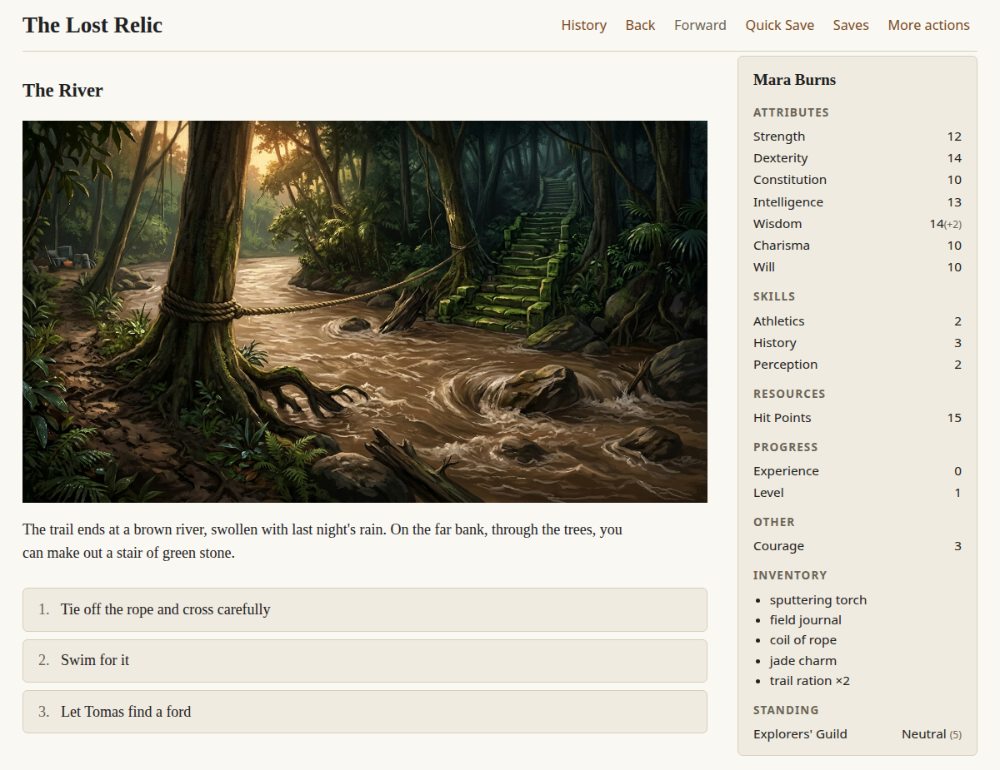
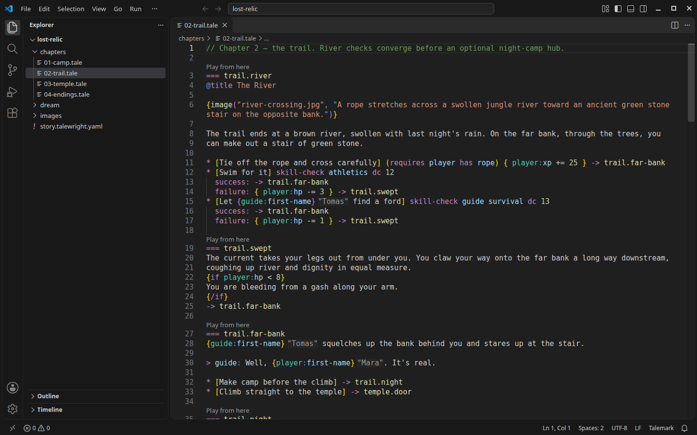

# Talewright


<sub>Temporary AI-generated artwork. I'd love to bring on a real artist as the project grows.</sub>

**Write a story someone can play.**

Talewright is for making text-based RPGs. You write the scenes, the dialogue and the choices. Your
characters can have skills, carry gear, earn experience and make enemies. What the player did earlier
decides what happens next.

Your story is plain text. Talewright handles the rules, the dice and the saves, and plays it in a browser
or as a desktop app.

**[Play a story now](https://play.trytalewright.com/)** by picking *The Lost Relic*. Nothing to install.

## What it looks like

Stories are written in **Talemark**. Here's a scene from *The Lost Relic*:

```tale
=== trail.river
@title The River

{image("river-crossing.jpg", "A rope stretches across a swollen jungle river toward an ancient green stone stair on the opposite bank.")}

The trail ends at a brown river, swollen with last night's rain. On the far bank, through the trees, you
can make out a stair of green stone.

* [Tie off the rope and cross carefully] (requires player has rope) { player:xp += 25 } -> trail.far-bank
* [Swim for it] skill-check athletics dc 12
  success: -> trail.far-bank
  failure: { player:hp -= 3 } -> trail.swept
* [Let {guide:first-name} find a ford] skill-check guide survival dc 13
  success: -> trail.far-bank
  failure: { player:hp -= 1 } -> trail.swept
```

And here's how it plays:



Start with a few scenes and choices. Add skill checks, items and factions when your story needs them.

## Writing it

The [VS Code extension](https://marketplace.visualstudio.com/items?itemName=squid-farm.talewright) adds
highlighting and suggestions, and catches mistakes as you type. It also shows a grey preview of what each
`{...}` placeholder will say, such as a character's name.



Any text editor works too.

Ready to try it? The **[first story tutorial](docs/guide/first-story.md)** takes about fifteen minutes, and
**[Getting started](docs/guide/getting-started.md)** covers setup.

## Why I made it

I've been writing software most of my life, and I still love it. I love working out hard problems and
getting the details right. I wanted to put all of that into something that helps other people make things.

I wanted a tool that's welcoming on day one and still has room to grow when your story gets ambitious.
Talewright is free and open source, and it will stay that way.

## Where it stands

Talewright works today. You can write, play, save, check, debug and publish stories. I'm writing a full
story with it before calling 1.0 ready, so the story format may still change until then. See
[where it's headed](docs/roadmap.md).

Once the first 1.0 preview ships, this promise applies:

> **1.0 preview: what stays stable.** From 1.0.0-preview.1, Talemark syntax, story files and saves made by
> a preview will keep working in later 1.x releases. We will break this only to fix a severe defect, such
> as a security or data-loss bug, and will announce it in advance, with an error that names the replacement
> and migration notes. Tooling, debugger scenario files and C# extension APIs may still change before 1.0.

**Learn more:** [Author guide](docs/guide/README.md) · [Talemark reference](docs/reference/talemark-syntax.md) ·
[Developer docs](docs/developer/README.md) · [Contributing](CONTRIBUTING.md)

## Thanks

Talewright wouldn't exist without [Twine](https://twinery.org/), [Ren'Py](https://www.renpy.org/) and
[ChoiceScript](https://www.choiceofgames.com/make-your-own-games/choicescript-intro/).
[Here's how they compare](docs/inspirations.md), and when one of them might suit your story better.

## License

[MPL-2.0](LICENSE). Use it for anything, including commercial games. Your stories are yours.
