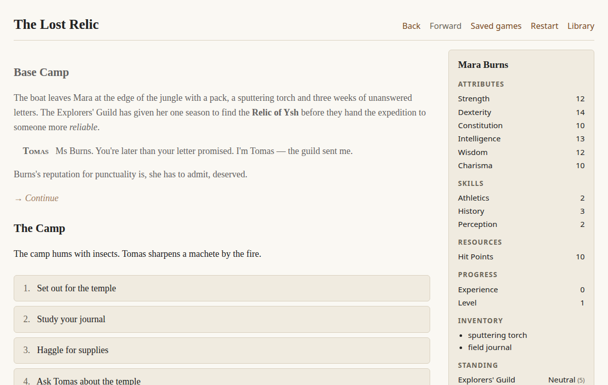

# Talewright


<sub>Banner art is AI-generated placeholder art. If Talewright earns its keep, a real artist gets the job.</sub>

**Write branching, stat-driven RPG stories in plain text. Play them on the web or the desktop.**

> ## ⚠️ PRE-1.0 PREVIEW: BACKWARD COMPATIBILITY IS NOT GUARANTEED
>
> Talewright is currently in public preview. Before `v1.0`, story syntax, save formats, APIs, tooling,
> and project structure may change without notice. **Do not expect backward compatibility until v1.**
>
> Development targets the current format and API, not compatibility shims or migrations for older
> versions. Any pre-v1 compatibility exception requires an explicit project-lead decision.

Talewright is an engine for text-first RPGs and visual novels with skill checks, inventories, factions
and many branches. **Talemark is the story-authoring language that powers your Talewright stories.**
Its `.tale` files combine bold, italic and code formatting with dialogue, choices, conditions, and RPG effects;
`story.talewright.yaml` defines your cast and rules. No programming required.

```tale
=== temple.entrance
{player:first-name#possessive} torch gutters as **cold air** spills from the door.

* [Climb the collapsed wall] skill-check athletics dc 14
  success: -> temple.upper
  failure: { player:hp -= 2 } -> temple.fall
* [Read the glyphs] (requires: player:int >= 12) -> temple.glyphs
```



## Features

- **Write in Talemark.** Plain-text stories with bold, italic and code formatting, dialogue lines, choices, and inline or block `{if}` conditions.
- **Proper RPG rules.** Stats, skills, d20 skill checks, items that modify stats, factions with
  reputation tiers, XP and levels. Use the default ruleset, tweak it, or replace it.
- **Big branching stories.** Hubs and storylets offer whichever scenes are currently available, so you
  don't have to wire every path by hand. Benchmarks compile 10,000-scene stories in under a second.
  See the [performance results](docs/developer/performance.md).
- **Grammar handled for you.** Names, pronouns (including custom sets), possessives ("Burns's") and a/an.
- **Errors caught before players see them.** Broken links, unknown items and typo'd stats are reported
  with file and line number when the story loads.
- **Saves, Back and Forward.** Named save slots plus full undo and redo, with consistent results.
- **Optional character creation.** Players can pick names, pronouns, presets and starting stats.
- **Share it anywhere.** Publish a story file, a static website (works on itch.io), or a desktop app.

## Try it now

Open the **[web player](https://play.trytalewright.com/)** and pick *The Lost Relic*. Nothing
to install.

## Set up your writing space

We recommend **VS Code with the [Talewright extension](https://marketplace.visualstudio.com/items?itemName=squid-farm.talewright)**:
write Talemark with highlighting, suggestions and live checks. **Linux x64** is runtime-tested;
Windows x64/ARM64, macOS Intel/Apple Silicon and Linux ARM64 are available with **provisional
support** (cross-built and inspected, not yet verified in the installed editor).
Each package includes its language server, with no .NET installation or source build needed.
See [Getting started](docs/guide/getting-started.md) for installation and platform details.

For **Validate Story**, **Publish Story ZIP** and **Open Author Debugger**, run
**Talewright: Set Up CLI** in the Command Palette. These actions use the separate story tools,
which setup helps you select or install with approval. Ready-to-use CLI downloads for Windows,
Mac and Linux are available from [Releases](https://github.com/squid-farm/talewright/releases).
See the [setup guide](docs/guide/cli-installation.md) for choosing a download and current testing limits.

Any plain-text editor also works. Zip your story folder and open it in the web player to check
and play it, without installing the extension or CLI.

## Write your first story

1. Open a story folder in your editor. Add `story.talewright.yaml` (settings and characters) and `story.tale` (scenes).
   You can also copy the [sample story](samples/LostRelic) and edit it.
2. Save your changes and run **Talewright: Validate Story**, or check a ZIP in the web player.
3. Use **Talewright: Publish Story ZIP**, or zip the folder yourself, then choose
   **Open a story file** in the [web player](https://play.trytalewright.com/).
4. Fix, check again, and replay.

The **[first story tutorial](docs/guide/first-story.md)** walks through this with a complete example.
The [Talemark syntax reference](docs/reference/talemark-syntax.md) starts with basic examples and
continues into the full language details.

## Share your story

```bash
talewright publish my-story --output my-story.zip                   # story file for any Talewright player
talewright publish my-story -a --target web --output game-web.zip   # static website, e.g. itch.io
talewright publish my-story -a --target desktop --output game.zip   # Windows, macOS and Linux app
```

These examples assume the CLI is installed as `talewright`; portable downloads use
`Talewright.Cli` (`Talewright.Cli.exe` on Windows). A story ZIP needs no .NET installation.
Building a standalone website or desktop game still requires the .NET 10 SDK on the author's
computer; players don't need .NET. See [Sharing your story](docs/guide/sharing-your-story.md).

## Documentation

| I want to… | Read |
|---|---|
| Learn to write stories | [Author guide](docs/guide/README.md) |
| Look up syntax or an error code | [Talemark syntax](docs/reference/talemark-syntax.md) · [Error codes](docs/reference/diagnostics.md) · [CLI](docs/reference/cli.md) |
| Extend the engine in C# or contribute | [Developer docs](docs/developer/README.md) · [Contributing](CONTRIBUTING.md) |

All docs start at the **[documentation home](docs/README.md)**.

## Source layout

This is a monorepo organized by responsibility:

- [engine/](engine/): headless libraries and compiler, with local tests.
- [player/](player/): reusable Blazor player and UI tests.
- [apps/](apps/): runnable web and desktop hosts.
- [tooling/](tooling/): authoring infrastructure, CLI, debugger,
  [language server](docs/developer/language-server.md), and VS Code extension.
- [packaging/](packaging/): aggregate engine NuGet packaging.
- [benchmarks/](benchmarks/): performance workloads and measurement tools.

Tests live with their area; root [tests/](tests/) contains repository-wide CI
contracts and the verification guide. Shared build settings and the
[solution](Talewright.slnx) stay at the root. See the
[contributor layout guide](CONTRIBUTING.md#repository-layout) for details.

## Project status

Talewright is in **preview**. Writing, playing, saving, validating, debugging and publishing all work.
The VS Code extension includes completion and live errors; story images are supported
in the web and desktop players. World simulation and combat remain future work.
Follow along on the [roadmap](docs/developer/plan.md#6-milestones) and the
[project board](https://github.com/orgs/squid-farm/projects/1).

## License

[MPL-2.0](LICENSE). Use Talewright for anything, including commercial games. Your stories are yours.
Changes to Talewright's own source files stay open.
