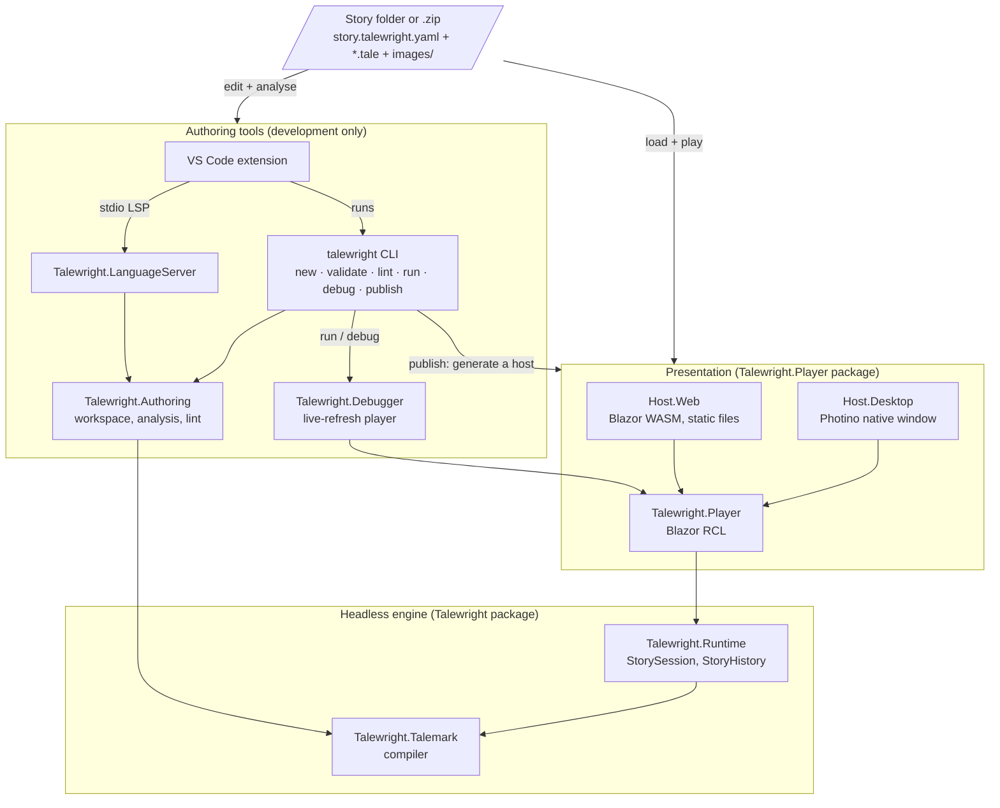
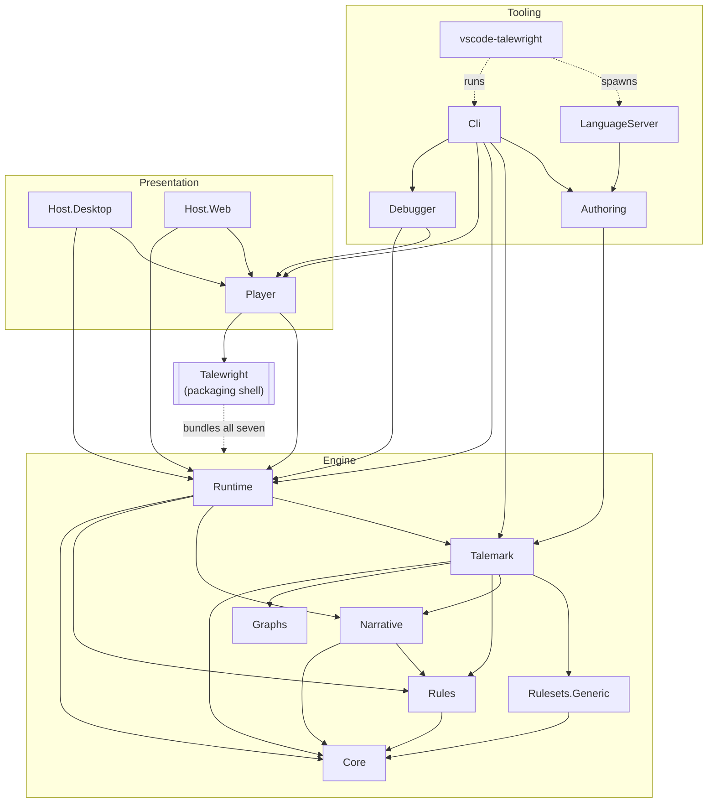
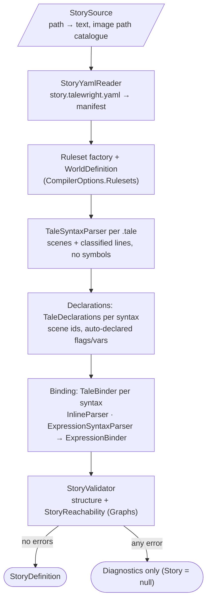
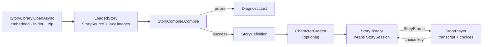
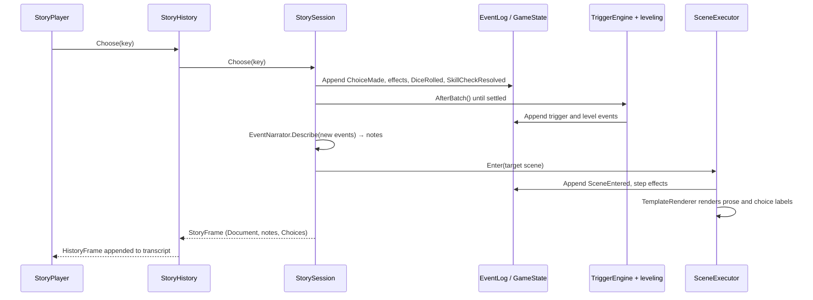
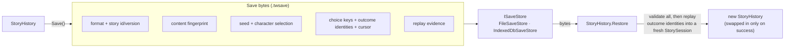

# Architecture

This is the guided tour of the code: what each project does, how a click becomes text on screen, where the
extension points are, and where to look when something breaks. The [design decisions](plan.md) record past
decisions and the [roadmap](../roadmap.md) says where the project is headed; this document records _what is actually
built_ and the rationale behind it. The
[Talemark syntax reference](../reference/talemark-syntax.md) is the authoritative reference for the story language.

Contents:

1. [The big picture](#1-the-big-picture)
2. [Invariants (the rules the code must keep)](#2-invariants)
3. [Project by project](#3-project-by-project)
4. [Life of a story: load → compile → play](#4-life-of-a-story)
5. [The engine loop in detail](#5-the-engine-loop-in-detail)
6. [Extension points](#6-extension-points)
7. [Where to find X](#7-where-to-find-x)
8. [Testing](#8-testing)
9. [Known limitations and seams left for later](#9-known-limitations-and-seams-left-for-later)

---

## 1. The big picture

Talewright is a **storylet engine** sitting on an **event-sourced RPG state**. A story is a set of _scenes_. Each
scene has prose (a template), optional requirements, effects, skill checks, choices and diverts. Nothing about
"which scene comes next" is hard-wired into the engine: scenes say where to go (`-> scene`, "rails"), or a hub scene
offers every storylet whose requirements currently hold ("hubs"). Nothing assumes linear flow, so the same
mechanism can later drive open-world locations.

### System overview

Two paths share one compiler. Authoring tools analyse story files while they are edited; players compile the
story when it loads and then play it. Neither path persists compiled stories.

`publish` generates a standalone web or desktop host project with the story embedded. Releases ship the
`Talewright` and `Talewright.Player` NuGet packages, the CLI and the VS Code extension; see [releasing](releasing.md).

### Layers

| Layer                 | Projects                                                              | One-line job                                                                         |
| --------------------- | --------------------------------------------------------------------- | ------------------------------------------------------------------------------------ |
| **RPG engine**        | `Talewright.Core`, `Talewright.Rulesets.Generic`                      | Who exists, what they have, what has happened. Pure state + events.                  |
| **Rules engine**      | `Talewright.Rules`                                                    | Evaluate conditions, apply effects, resolve checks, fire triggers, select storylets. |
| **Template renderer** | `Talewright.Narrative`                                                | Turn a typed template AST + state into a presentation-agnostic document.             |
| **Compiler**          | `Talewright.Talemark`, `Talewright.Graphs`                            | Text → typed `StoryDefinition` or diagnostics. The only place that parses strings.   |
| **Orchestrator**      | `Talewright.Runtime`                                                  | `StorySession` runs the loop (choice → events → rules → render → frame).             |
| **Presentation**      | `Talewright.Player`, `Talewright.Host.Desktop`, `Talewright.Host.Web` | Blazor UI and the two native/web shells.                                             |
| **Tooling**           | `Talewright.Authoring`, `.LanguageServer`, `.Cli`, `.Debugger`        | Editor analysis, lint, validate/run/publish. Never shipped inside a story.           |

`Talewright.Authoring` is a development-tool library above the compiler. It owns
unsaved workspaces, analysis scheduling, explicit project metadata integration,
and the shared Talemark-aware lint rules/configuration consumed by the CLI and editor.
The compiler exposes parser-backed partial analysis without depending on this
library. Authoring is excluded from the shipped engine and player packages; see
[shared authoring analysis](authoring-analysis.md) and the [language server](language-server.md).

`Talewright.Graphs` is an independent directed-graph library. It has no project or
package references, so the graph model never depends on Talewright types. `Talewright.Talemark`
references it to find which scenes the start scene can reach (TW3009).

### Dependency graph

Solid arrows are `ProjectReference`s in shipped projects (tests, benchmarks and `examples/` are omitted).
Dotted arrows are process or packaging relationships, not compile references. Nothing points upward: the
engine never knows about the UI or the tooling.

`Narrative` references `Rules` because inline conditionals `{if …}` use the same typed expression trees and
evaluator as everything else.

### NuGet distribution

The `packaging/Talewright/Talewright.csproj` shell privately references all seven engine projects
(Core, Graphs, Rules, Narrative, Rulesets.Generic, Talemark, Runtime) and packages their existing assemblies
together as `Talewright`; it contains no engine implementation. `Talewright.Player` retains its direct Runtime
project reference, and its published package depends on `Talewright`. Both packages share one version.
The component projects are not separately published. Namespaces and assembly identities are independent of
source paths; packaging is independent of code organization.

Ordinary story authors need no NuGet project dependencies. C# customizers normally
install only `Talewright.Player`; headless/custom-UI consumers install `Talewright`.

Talewright uses [MPL-2.0](../../LICENSE), a file-level copyleft license. Games built with it
may use their own licenses, including commercial ones. Distributing changes to MPL-covered
Talewright files carries the license's source-availability obligations.

### Repository areas

The workspace is organized by responsibility, not by implementation language:

- `engine/src` and `engine/tests`: reusable headless libraries and their tests.
- `player/src` and `player/tests`: reusable UI, opt-in end-to-end suites, and their runners.
- `apps/web` and `apps/desktop`: runnable hosts of the player.
- `tooling/authoring`, `tooling/cli`, `tooling/debugger`, and
  [`tooling/language-server`](language-server.md): development tools,
  each with local source/tests where applicable. The VS Code extension remains
  in `tooling/vscode-talewright`.
- `packaging/Talewright`: the aggregate NuGet packaging shell.
- `benchmarks`: performance budgets, BenchmarkDotNet workloads, and report tooling.
- Root `tests`: repository-wide CI/Nx contracts only.

The root solution mirrors these areas. Shared story fixtures are in
`engine/tests/Talewright.TestStories`; the separate player E2E solution remains
opt-in. Root build defaults, [Nx and CI](nx-ci.md) coordinate all areas. See
[Contributing](../../CONTRIBUTING.md#repository-layout) for paths and commands.

### The data that flows between layers

| Boundary             | Type                                                                | Defined in |
| -------------------- | ------------------------------------------------------------------- | ---------- |
| Story files → engine | `StorySource` (path → text map)                                     | `Talewright.Talemark` |
| Compiler → runtime   | `StoryDefinition` (world, scenes, triggers, predicates)             | `Talewright.Talemark` |
| Rules ↔ state        | `IGameStateView` (read) and `GameEvent`s (write)                    | Core       |
| Templates → renderer | `TemplateBlock` / `TemplateInline` AST                              | Narrative  |
| Renderer → UI        | `RenderedDocument` (blocks, styled runs, notes, media placeholders) | Narrative  |
| Runtime → UI         | Full `StoryDefinition` (used by Player for creation data), `IGameStateView`, and `StoryFrame` | Talemark / Core / Runtime |
| Session API          | `IStorySession.Events` (events emitted in the current session)      | Runtime    |
| UI → runtime         | a choice **key** string (`StoryHistory.Choose` / `IStorySession.Choose`) | Runtime |

The Player consumes `StoryDefinition` for character creation (including creation choices and ruleset stats),
renders `StoryFrame`/`ChoiceView`, and reads `IGameStateView` for the character sheet. `IStorySession` also
exposes the compiled definition and event history as public contracts. The Player does not interpret `Expr`
or `Effect`, or execute `SceneDefinition.Steps`; `StorySession` owns scene execution. `StoryPlayer` uses
`StoryHistory` for transcript, Back/Forward and save orchestration; presentation does not reimplement replay.

`Talewright.Runtime` also owns the headless `AuthorSession` API for synthetic scene starts, state edits,
jumps and reload checkpoints. `StoryHistory.ForkAuthor` adapts a player's validated choice history into
that author timeline; the debugger consumes the API and does not own its replay semantics. `StorySession`
retains internal author hooks for setup, entry-boundary capture and live refresh because those operations
must share engine event and scene execution. Keep debugger/UI dependencies out of Runtime and keep player
saves and author command/scenario formats distinct.

---

## 2. Invariants

These are load-bearing. Breaking one will break saves, replays, tests or the "decoupled" promise.

1. **State changes only by applying `GameEvent`s.** `GameState.Apply(event)` is the only mutator, and
   `EventLog.Append` is the only caller. State is `fold(initial, events)`. Want a new kind of change? Add an event.
2. **Dice results live in events.** `DiceRolled` stores the value, so folding an existing event log never
   re-rolls. Player saves do not persist that log: they store a seed and choice history, then recreate the
   session by replaying the story. `DeterministicDice.Roll(seed, index, sides)` makes that replay reproducible.
3. **The engine has no built-in stats.** Strength, hit points, levels, reputation tiers, how checks resolve: all
   come from the `Ruleset`. `Talewright.Core` does not mention "strength" anywhere. The d20 set is an
   opt-in module (`ruleset: rpg`; see decision D20 in the [design decisions](plan.md)).
4. **No string parsing at play time.** Templates and conditions are compiled into typed trees (`Expr`,
   `TemplateInline`, `Effect`). Rendering a frame walks trees; it never parses.
5. **No reflection or runtime code generation in the engine.** This keeps Blazor WASM trimming safe. Extension
   is by registering objects/delegates (predicates, modifiers, rulesets), not by scanning assemblies.
6. **Stories are data, outside the engine.** `samples/` is not referenced by engine code. Hosts merely bundle it.
7. **No fixed "next scene" pointer.** Movement is the `SceneEntered` event. A scene never "owns" its successor;
   it requests one. This is what keeps the door open for open-world play (locations, travel, time).
8. **The renderer never produces HTML.** It produces `RenderedDocument`. The Player turns that into HTML; a
   future console or Unity front-end could turn it into something else.

---

## 3. Project by project

Each project also has its own `README.md` with a file-by-file guide. This section is the summary.

### 3.1 `Talewright.Core` — the RPG engine

Folders:

- **`Identity/Ids.cs`**: strongly typed ids (`EntityId`, `StatId`, `ItemId`, `FactionId`, `SceneId`, `FlagId`,
  `VarId`). They are readonly record structs wrapping a string, so you can't pass a stat where a faction is
  expected. `EntityId.Player` is the well-known player id.
- **`Rulesets/`**: the "what kind of game is this" layer.
  - `StatDefinition(Id, Name, Category, Min, Max, Default, GoverningAttribute)`. A stat is just an integer with
    bounds and a display name. `StatCategory` (Attribute, Skill, Resource, Progression, Custom) is only used for
    grouping (the character sheet uses it).
  - `ReputationTier(Id, Name, Minimum)`: named bands of faction standing (hostile … allied).
  - `ISkillCheckRule`, `ILevelingRule`, `IStatModifier`: the pluggable behaviours. See §6.
  - `Ruleset` is immutable; `RulesetBuilder` builds it with `AddStat` / `RemoveStat` / `ReplaceStat` /
    `WithTiers` / `WithSkillCheckRule` / `WithLevelingRule` / `AddModifier`. `ruleset.ToBuilder()` starts from an
    existing one, which is how a story "turns off" stats it doesn't want.
- **`World/`**: static definitions. `CharacterDefinition` (names, pronouns, starting stats and inventory),
  `ItemDefinition` (name + stat modifiers while held), `FactionDefinition`, and `WorldDefinition`, which bundles
  them all with the ruleset. `Pronouns` holds subject/object/possessive/reflexive forms plus presets.
- **`Events/GameEvents.cs`**: every possible change, as records: `StatChanged`, `ItemsGranted`, `ItemsRemoved`,
  `StandingChanged`, `FlagChanged`, `VariableChanged`, `SceneEntered`, `ChoiceMade`, `DiceRolled`,
  `SkillCheckResolved`, `LevelChanged`, `TriggerFired`, `StoryEnded`. Events store **absolute new values**
  (`StatChanged(..., OldValue, NewValue)`), not deltas, so they are self-describing in a log.
- **`State/`**:
  - `IGameStateView`: the read-only query surface everything else uses (`GetStat`, `GetBaseStat`,
    `GetItemCount`, `GetInventory`, `GetStanding`, `GetFlag`, `GetVariable`, `VisitCount`, `HasFiredTrigger`…).
  - `GameState`: the projection. `CreateInitial(world, seed)` + `Apply(event)`. `GetStat` = base stat + every
    `IStatModifier` + held items' modifiers, clamped to the stat's bounds.
  - `EventLog`: owns a `GameState` and the event list. `Append`, `AppendRange`, `Replay(world, seed, events)`,
    `Truncate(count)` (unused by Back/Forward, which replays instead), and an `Appended` event.
  - `StateChanges`: helpers that _compute_ the events for a change (`AdjustStat`, `GiveItem`, `SetStanding`,
    `CheckLevel` …). They clamp values and return nothing if nothing changes. Use these rather than building
    events by hand.
- **`Randomness/DeterministicDice.cs`**: SplitMix64-based `Roll(seed, index, sides)`. The index is
  `state.RollCount`, which advances with each `DiceRolled` event.

### 3.2 `Talewright.Rulesets.Generic` — the opt-in d20-flavoured RPG ruleset

`GenericRuleset.Create()` builds: six attributes (`str dex con int wis cha`, 1–30, default 10), a list of skills
each governed by an attribute (athletics→STR, perception→WIS, history→INT, survival→WIS …), `hp`, `xp`, `level`,
the five reputation tiers, `D20SkillCheckRule` (d20 + skill + attribute modifier vs DC; with randomness off it
"takes 10"), and `ExperienceLevelingRule` (level _n_ needs 100 × _n_ × (_n_ − 1) / 2 XP: 0, 100, 300, 600 …; max 20). It is registered under the name `rpg`;
the C# names keep `Generic`. A story opts in with `ruleset: rpg` or `ruleset: { base: rpg }`. Without a
`ruleset`, or with a `ruleset` mapping that has no `base`, a story uses `none` (no stats or levelling; just the
tiers and `D20SkillCheckRule`, so checks work on declared stats) plus any stats it declares. Both are listed in `CompilerOptions.DefaultRulesets()`. Unknown names report
TW4004 and recover with `rpg` so stat references keep resolving.

### 3.3 `Talewright.Rules` — the rules engine

- **`Expressions/`**: the typed condition/value language.
  - `Expr` is an abstract record with one subclass per node: literals, `StatRef`, `StandingRef`,
    `StandingTierRef`, `FlagRef`, `VarRef`, `HasItem`, `Visited`, `NamedPredicate`, `NameRef`, `PronounRef`,
    `ItemNameRef`, `FactionNameRef`, `UnaryExpr`, `BinaryExpr`. Each node has an `ExprType` (Number, Bool,
    Text, Tier) checked at compile time.
  - `ExpressionEvaluator.Evaluate(expr, EvaluationContext)` → `Value`. The context is the state view plus the
    `NamedPredicateRegistry`.
  - `NamedPredicateRegistry`: C#-defined conditions callable from stories as `@Name`. The escape hatch for logic
    too hairy for an expression.
- **`Effects/Effects.cs`**: `ChangeStat`, `ChangeStanding`, `ChangeVariable`, `SetFlag`, `GiveItem`, `TakeItem`,
  each with an `AssignOp` (`=`, `+=`, `-=`). `EffectExecutor.Execute` evaluates the amount and appends the
  events from `StateChanges`.
- **`Checks/SkillCheckResolver.cs`**: `SkillCheck(Actor, Skill, Difficulty)` + `RandomnessMode` (`Off`,
  `ChecksOnly`). Rolls the ruleset's die (appending `DiceRolled`), asks the ruleset's `ISkillCheckRule` for the
  result, and appends `SkillCheckResolved`.
- **`Triggers/TriggerEngine.cs`**: `TriggerDefinition(Id, When, Effects, Once)`. After every change the runtime
  calls `Run(log)`, which fires triggers whose condition has become true (edge-triggered: it fires on
  false→true, not every frame). It loops until stable, capped at `MaxPasses = 32`; reaching the cap with
  eligible triggers remaining throws an error instead of silently skipping effects.
- **`Storylets/StoryletSelector.cs`**: `IStorylet` (Id, Requires, Tags, Priority, Once) and `SelectEligible(…,
  StoryletTags, context)`. Eligible = matches the tag query, requirements hold, and not already visited
  if `Once`. Ordered by priority (high first), then declaration order. `SceneDefinition` implements
  `IStorylet`; its `Hub` is one tag-query representation for single-tag, all and any author syntax.

### 3.4 `Talewright.Narrative` — the template renderer

- **`Templates/Template.cs`**: the input AST.
  - Blocks: `ParagraphTemplate`, `SpeechTemplate` (speaker + line), `ConditionalBlockTemplate`.
  - Inlines: `TextTemplate`, `StyledTemplate` (emphasis/strong/code, nested via `TextStyle` flags),
    `LineBreakTemplate`, `MediaTemplate` (resolved images), `SubstitutionTemplate` (an `Expr` plus a list of
    text modifiers), `ConditionalInlineTemplate`.
  - Note: this is what "strongly typed, not string parsing" means in practice. `{player:first-name#possessive}`
    compiles to `SubstitutionTemplate(NameRef(player, First), [possessive])`.
- **`Templates/TextModifiers.cs`**: `ITextModifier` (`#possessive`, `#capitalize`, `#upper`, `#lower`,
  `#a`, `#bold`, `#italic`) and `TextModifierRegistry`. Text modifiers declare accepted and output kinds;
  `#bold` and `#italic`
  lower to `StyledTemplate` with the same `TextStyle` as prose formatting. Register your own to add
  `#whatever`.
- **`Grammar/EnglishGrammar.cs`**: `IGrammar` with Chicago-style possessives (`Burns's`, `the guards'`),
  a/an, capitalisation. Swap the grammar to localise or change style.
- **`Rendering/`**: `TemplateRenderer.Render(blocks, state)` → `RenderedDocument`. Output types:
  `RenderedParagraph`, `RenderedSpeech`, `RenderedNote` (system messages like "Gained: rope", with a
  `NoteKind`), and inlines `RenderedText(Text, Style)`, `RenderedLineBreak`, `RenderedMedia(MediaId, AltText)`.

### 3.5 `Talewright.Talemark` — the compiler

Talemark is the story language; Talewright is the engine, player and tooling brand.
See [compiler assembly name](csharp-extensions.md#compiler-assembly-name) for how the assembly, API names,
`.tale` extension and editor identities relate.

Entry point: `StoryCompiler.Compile(StorySource, CompilerOptions?) → CompilationResult(Story?, Diagnostics)`.

Each `.tale` file is split into syntax once. Declaration collection walks every file's syntax before any file
is bound, so forward references resolve; only binding runs the full binder. The player compiles
at story load, including in WebAssembly, so parser cost is load-time cost; see [performance](performance.md).

- **`Compilation/`**
  - `StorySource`: a dictionary of relative path → text, plus an immutable `ImagePaths` catalogue of
    story-root-relative paths under `images/`. Image bytes are not read or decoded.
    In-memory callers can supply image paths through the constructor.
    Factories: `FromDirectory`, `FromZip(stream)` (a
    single wrapping top-level folder is stripped). `ReadTitle()` peeks at `story.talewright.yaml` without compiling (used
    by the library screen).
  - `StoryImageResolver`: the shared, path-only image lookup used by compilation, `talewright validate`,
    editor analysis and completion. It never reads or decodes image bytes. Path rules, alt-text defaults and
    export behaviour are in the [Talemark README](../../engine/src/Talewright.Talemark/README.md#story-images).
  - `CompilerOptions`: the registries the compiler resolves names against: `Predicates` (for `@Name`),
    `Modifiers` (for `#mod`) and `Rulesets` (name → factory, for `game.ruleset.base:`). C# extension means
    "pass your own options"; see [C# extensions](csharp-extensions.md).
  - `StoryCompiler`: orchestrates. Order: read `story.talewright.yaml` → build ruleset and `WorldDefinition` → declaration collection over
    every `.tale` syntax for scene ids and auto-declared flags/vars (so forward references work) → parse each `.tale` →
    validate → assemble `StoryDefinition`. Any error ⇒ `Story` is null.
  - `StoryValidator`: whole-story checks after parsing: start scene exists, choices form the final block
    and have explicit targets, no dead ends, empty hubs, unreachable steps and scenes.
- **`Parsing/`**
  - `StoryYamlReader`: `story.talewright.yaml` → manifest (uses YamlDotNet's node model, not reflection-based
    deserialisation, for trimming and precise error locations).
  - `TaleSyntaxParser`: symbol-independent `.tale` file syntax. It splits lines, assigns them to scenes and
    classifies `=== scene` headers, `@directives`, `~ effects`, `* choices`, `-> diverts`, `::: skill-check`
    fences and outcomes, `{if}` blocks, speech lines and prose with scene-relative spans. It also checks block
    structure, malformed metadata, speech, divert, choice and skill-check lines, and attaches outcome lines to
    their check. Choice and skill-check lines record clause spans.
  - `TaleDeclarations`: walks that syntax for scene ids and effect text before binding, so story-wide flags
    and vars are known up front. It does not run the binder.
  - `TaleBinder`: binds that syntax to scenes and steps. See the Talemark README for syntax/binding ownership.
  - `InlineParser`: reader text → inline template AST. Uses the shared delimiter scan for braces, then tokenizes
    constructs, escapes, line breaks and bounded formatting directly; unsupported Markdown remains literal.
  - `DelimiterScanner`: pairs enclosing delimiters and quoted strings; it does not parse the meaning inside them.
    Its modes reflect which delimiters matter in reader text, choice labels and code groups. The same quoted-string
    boundary logic is shared with `QuotedStringSyntax`, which also decodes escapes for the lexer and image arguments.
    Reader-text escape characters are defined once and used by the scanner and reader-text consumers.
  - `Lexer` owns token boundaries. `ExpressionSyntaxParser` parses conditions, numbers, substitutions and effects
    into immutable, span-based syntax without story symbols; `ExpressionBinder` resolves names and types and builds
    the existing runtime expression/effect models. `ExpressionParser` is the compile-facing parse-and-bind facade.
    Syntax nodes refer to the shared token buffer rather than copying source text. Compilation and authoring analysis
    reuse token buffers across expression consumers, and variable inference rebinds one parsed initializer as symbols
    become known. Syntax trees are transient compiler data, not retained by `StoryAnalysis`. Quoted strings are
    decoded only when a consumer needs their value; `QuotedStringSyntax` provides the shared boundary and decoding rules.
  - `StorySymbols`: what's declared (stats, characters, items, factions, flags, vars, scenes), for resolving
    names.
- **`Model/StoryDefinition.cs`**: the compiled story. `StoryDefinition` (Id, Title, Start, Randomness, Seed,
  World, Scenes, Triggers, Predicates), `SceneDefinition`, `ChoiceDefinition`, `CheckBranch`/`CheckOutcome`,
  `ConditionalEffect`, `ConditionalDivert`, `DivertTarget` (`End` is a target too).
  Compiled stories retain source positions for debugging, but not full source text or editor workspaces.
- **`Diagnostics/Diagnostic.cs`**: `Diagnostic(Severity, Code, Message, SourceLocation(File, Line, Column))`.
  Codes are documented in the [diagnostics reference](../reference/diagnostics.md).

#### Reader-text parser rationale

Talemark owns a small reader-text grammar rather than using a Markdown library. A CommonMark parser
silently loses prose that looks like setext headings, reference definitions or links, and applies
formatting and entity decoding that Talemark doesn't specify. Masking story constructs, mapping source
positions and bounding cancellation would also need extra plumbing. The grammar recognizes only
documented Talemark constructs and keeps anything else as literal text.

Substitution-capable text uses the same reader grammar, including image alt text even when it has
no substitution. An argument's slot determines whether it is a name, expression, literal text or
reader text; quotation marks only delimit it. The current rules and before/after examples live in
the [reader-text grammar](../reference/talemark-operators.md#reader-text-grammar).

### 3.6 `Talewright.Runtime` — the orchestrator

- `IStorySession`: `Start()`, `Choose(key)`, `Current`, `State`, `Events`, `Seed`, `Story`. The UI's only
  contract.
- `StorySession`: the engine loop (§5).
- `StoryFrame(Scene, Title, Document, Choices, IsEnded)`: `Choices` contains available choices only; `Menu` carries all shown entries in order with stable numbers and availability.
- `EventNarrator.Describe(events, state)`: turns the events produced by an action into `RenderedNote`s
  ("Athletics check: 10 +2 = 12 vs DC 12 — success", "Gained: rope", "Explorers' Guild −20 (now Unfriendly)",
  "Level 2!"). This is why authors never write "you lost 3 HP" by hand.

### 3.7 `Talewright.Player` — the shared Blazor UI (Razor Class Library)

- `Components/TalewrightApp.razor`: the whole app. Library screen (list + `.zip` upload) → compile → either show
  diagnostics or play. Hosts render only this. Opening the library mid-story keeps the player mounted (hidden),
  so a "Back to …" button resumes the playthrough; picking a story from the list starts it fresh.
- `Components/StoryPlayer.razor`: one playthrough. Keeps a transcript of past frames (echoing the chosen label),
  shows current choices, Back/Forward, named manual saves and Restart/Library buttons. Its collocated `StoryPlayer.razor.js` module scrolls the
  newest frame to the top of the viewport and focuses it (moving screen readers to it); plain `focus()` would
  not scroll a frame that is already partly visible. A delayed initial reveal does not steal focus from
  a control the player has already selected.
- `Components/DocumentView.razor`, `InlineView.razor`: `RenderedDocument` → HTML (`
`, `<em>`, `<strong>`,
  `<code>`). `RenderedMedia` preserves inherited style and renders through `MediaView` on all narrative
  surfaces, including choices and chosen-label history.
- `Components/MediaView.razor` and its JavaScript module: viewport-lazy image streaming into a Blob URL.
  Each mounted occurrence owns its observer, cancellation and image lease; one accepted `StoryImages`
  generation shares a transfer/Blob URL for each resolved path. Retained history keeps leases; final
  release retires an entry and revokes its URL, without affecting a newer entry for the same path.
  Owner teardown drains asynchronous cleanup. This reduces duplicates, not total unique-image retention.
  Missing, unsupported-source or undecodable assets show effective alt plus an accessible visible failure.
- `Components/CharacterSheet.razor`: generated from ruleset metadata; whatever stats the story's ruleset has,
  grouped by `StatCategory`. Skills at 0 are hidden. Shows inventory and faction standings with tiers.
- `Components/DiagnosticList.razor`: compiler errors/warnings with file:line:col.
- `Components/CharacterCreator.razor`: optional author-bounded creation form. `TalewrightApp` validates
  selections before constructing history; presets/identity/stats become initialization events, never
  changes to shared static world definitions. Restart keeps the active (including restored) character.
- `Saves/`: `FileSaveStore` uses staged atomic file replacement; `IndexedDbSaveStore` uses browser transactions.
  Failures are visible and rejected restores do not replace live history or mutate the stored save.
- `Library/StoryLibraries.cs`: `IStoryLibrary` (List/Load/Open) with `EmbeddedStoryLibrary` (stories compiled into
  the host assembly), `FileSystemStoryLibrary` (folders/zips; desktop only) and `CompositeStoryLibrary`.
- `Library/StoryImages.cs`: loaded-story-side lazy folder/embedded resource access and generation lifetime.
  Uses the compiler's safe image catalogue, with symbolic-link rechecks for live folder opens. Discovery
  never loads image bytes; `StorySource` and `TemplateRenderer` remain free of I/O ownership.
  Built-in hosts explicitly opt into embedded images. Published web games load images over HTTP through
  `PublishedStoryLibrary`, and published desktop games read them from the story folder.
  The folder debugger replaces this capability only on accepted refresh, including image-content edits.
- `wwwroot/talewright.css`: all player styles, driven by CSS variables (`--tw-bg`, `--tw-accent`…), with a dark
  mode via `prefers-color-scheme`. Hosts link it as `_content/Talewright.Player/talewright.css`.
  Embedded hosts can opt into `CharacterCreator.Compact` or disable `StoryStage.ShowCharacterSheet`;
  player-owned styles implement those presentations. A named `story-stage` inline-size container
  makes the stage responsive to an embedded pane, and `--tw-scene-title-margin-top` /
  `--tw-choices-margin` customize passage spacing without targeting player classes.
  Debugger chrome uses a shared `debugger-chrome` Razor CSS scope, assigned to every debugger
  component in its project file. Shared defaults live in `Workbench.razor.css`; player-rendered
  elements never receive that scope. Keep `wwwroot/debugger.css` limited to host sizing and do not
  use deep selectors or target player classes from debugger styles.

### 3.8 The hosts

Both thin hosts reuse one `Talewright.Player` Razor Class Library rather than maintaining separate
UIs. Photino provides a Linux-capable desktop host; WebAssembly provides a static web build.

- **`Talewright.Host.Desktop`** (Photino.Blazor): a native window using the OS webview (WebView2 / WKWebView /
  WebKitGTK). No browser, no server, no ports. `Program.cs` registers a composite library (embedded samples +
  command-line paths) and auto-opens the first path. `wwwroot/index.html` is the shell page.
- **`Talewright.Host.Web`** (Blazor WebAssembly): `dotnet publish` produces static files only, so any static host
  works (GitHub Pages, itch.io, an S3 bucket, `python -m http.server`). There is no router on purpose: one
  screen means no URL-rewrite rules when hosted in a subfolder. Change `<base href>` in `wwwroot/index.html` for
  subfolder hosting.

Both hosts embed `samples/**/*.tale|yaml` as resources named `stories/<Story>/<path>` (see the `EmbeddedResource`
item in each `.csproj`). That avoids any HTTP fetching or manifest files for the bundled stories.
Story resources disable MSBuild culture inference so names such as `chapter.fr.tale`
stay in the main assembly. The CLI builds standalone hosts using explicit Razor/HTML
templates (including a relative web base path); project changes use `XDocument` and
`XElement` serialization, not hand-built XML or replacements inside component source.

---

## 4. Life of a story

1. **Load.** The host's `IStoryLibrary.OpenAsync` hands back a disposable `LoadedStory`: `StorySource` plus
   optional lazy image access. The UI owns it, not the compiler/runtime. Failed adoption preserves the
   accepted capability; successful replacement releases it. Folder assets are live, not byte snapshots.
   For an uploaded zip, `TalewrightApp` buffers
   it into memory first (browser streams aren't seekable) and transfers ownership to
   `ArchiveStoryImages.Open`. The player retains the parsed archive and uses `StorySource.FromZip`
   for the shared source/root/member mapping. Image reads enforce the archive expansion budget
   without counting repeated reads as new content; no expanded image cache is retained by the adapter.
2. **Compile.** `StoryCompiler` reads `story.talewright.yaml`:
   - `ruleset` (a name) or `ruleset.base` picks a ruleset factory (`rpg`, `none`, or one you registered;
     omitted means `none`); `ruleset.disable`
     removes stats; `ruleset.stats` adds or overrides them.
   - `characters`, `items`, `factions`, `flags`, `vars`, `triggers` become the `WorldDefinition` and
     `TriggerDefinition`s.
   - Then every `.tale` file (sorted by path, subfolders allowed) is parsed into `SceneDefinition`s. Names are
     resolved and type-checked here, so `player:strenght` is a TW2xxx error at load time, not a crash at chapter 9.
3. **Play.** Fixed stories start immediately; creation stories first validate and snapshot an author-approved
   selection. `StorySession` creates an `EventLog` from world + seed, applies character initialization,
   primes triggers and enters the start scene. Every `Choose(key)` appends events and returns a new frame.
   `StoryHistory` replays a fresh session from the seed and choice history for save restore and Back/Forward;
   it validates the entire saved redo sequence before replacement, preserving deterministic dice and trigger edge memory.
4. **Render.** `StoryPlayer` appends each frame to its transcript and asks `DocumentView` to draw it. The character
   sheet re-reads `IGameStateView` on each render, so it's always current.

---

## 5. The engine loop in detail

`StorySession` owns transitions and presentation. `SceneExecutor` interprets the compiled
`SceneDefinition.Steps`; the same nested step model is used by validation and inspection.

**Entering a scene** (`Enter`):

1. Append `SceneEntered(scene)` (this increments the visit count).
2. Settle visit-trigger consequences through `AfterBatch` (bounded triggers and leveling).
3. Execute steps in source order: render prose against the current state, decide each conditional block
   once, apply each effect line as a batch, and resolve checks when reached.
4. After each effect/outcome batch, `AfterBatch` settles triggers and leveling. Insert `EventNarrator` notes
   at that point, before rendering the next prose step.
5. Collect choices when reached: evaluate requirements and render their labels then. The compiler requires
   choices to be the final block, but the executor itself does not impose a separate choice phase.
6. A reached divert stops all later steps, offering **Continue**, or ending with the current frame for END.
   Otherwise offer collected choices followed by eligible hub storylets (keys `storylet:<scene-id>`).
   Filter requirements/once/self, order by priority then declaration order, and apply `@hub-limit` only
   to generated choices. A scene divert never acts as a fallback for choices or hubs.

One choice, end to end:

**Choosing** (`Choose(key)`):

1. Append `ChoiceMade`.
2. Run the choice's effects as one batch, then `AfterBatch`.
3. If the choice has a skill check, resolve it (`DiceRolled` + `SkillCheckResolved`) and run the success or
   failure effects.
4. `AfterBatch()` for that outcome (triggers, leveling).
5. Collect notes for everything that happened. They are shown at the top of the _next_ frame.
6. Go to the choice's (or outcome's) explicit target. Missing targets are compile errors.
   `BeforeTransition` clears the old actions and author entry boundary before the next scene begins.

Steps carry stable source-position IDs and spans. Choice keys still count choice steps in source order.
Shared structural walks exclude steps beyond guaranteed exits, keeping validator reachability consistent
with the model consumed by the story map. The replay fingerprint salt is `talewright-replay-v3`;
compiled choices also carry stable outcome identities independent of their live UI keys.

Invalid keys throw `InvalidOperationException` listing the valid ones. The UI only ever sends keys it was given.

**Saves, restore and Back/Forward.** Saves store replay inputs, never the event log or state:

Back and Forward use the same replay: `StoryHistory` rebuilds a session from the seed and the first
_cursor_ outcome identities. Live choice keys still identify player actions; evidence-backed saves
use outcome identities for replay compatibility.

**Determinism.** Given the same `StoryDefinition`, seed, snapshotted character selection and sequence of
keys, a session produces the same events, frames and ending. Saves store those inputs plus cursor,
format/story versions, source/extension fingerprint, outcome identities and replay evidence. The
compatibility check replays the full recorded path, including redo, against an updated story. Unknown,
corrupt or incompatible saves are rejected without rewriting the original.
Event sourcing alone does not provide compatibility with changed stories or event schemas.
Restore verifies replay into a replacement session before adopting it; failure leaves the active
session untouched. This is a replay compatibility boundary, not general state migration.
Saves use a compressed, positional binary format (MessagePack arrays plus zlib);
see [Save format](save-format.md) for the array-key rules and limits. Fixed-protagonist
stories omit the character. Once 1.0.0-preview.1 ships, replay contracts are frozen and saves made by a
preview must keep loading; see the [compatibility freeze](../../CONTRIBUTING.md#compatibility-freeze).

---

## 6. Extension points

This is how the "dating sim doesn't want strength" requirement is met, and where a community author plugs in.

| I want to…                                        | Today (no code, story.talewright.yaml)                                                              | With C# (`Talewright` / `Talewright.Player` packages)                      |
| ------------------------------------------------- | ---------------------------------------------------------------------------------------- | -------------------------------------------------------------------------- |
| Remove RPG stats                                  | `game: { ruleset: { base: rpg, disable: [str, con] } }`                                  | `GenericRuleset.Create().ToBuilder().RemoveStat(...)`                      |
| Start from nothing                                | omit `game.ruleset`                                                                      | `new RulesetBuilder("mine")`                                               |
| Add stats (affection, sanity…)                    | `game: { ruleset: { stats: [ { id: affection, name: Affection, category: custom, max: 100 } ] } }` | `builder.AddStat(new StatDefinition(...))`                                 |
| Change how checks work (2d6, percentile, no dice) | pick a ruleset that has the rule                                                         | implement `ISkillCheckRule`, `WithSkillCheckRule`                          |
| Change levelling                                  | —                                                                                        | implement `ILevelingRule`                                                  |
| Derived stats, conditions, auras                  | items with `modifiers`                                                                   | implement `IStatModifier`, `AddModifier`                                   |
| Rename reputation tiers                           | —                                                                                        | `WithTiers(...)`                                                           |
| Complex conditions                                | —                                                                                        | `NamedPredicateRegistry.Register("IsMidnight", s => …)`, use `@IsMidnight` |
| New text modifier (`#shout`)                      | —                                                                                        | `TextModifierRegistry.Register(new DelegateTextModifier("shout", …))`      |
| Other language / possessive style                 | —                                                                                        | implement `IGrammar`, pass to `StorySession`                               |
| Different story source (database, HTTP)           | —                                                                                        | implement `IStoryLibrary` and register it in the host                      |
| Different UI (console, Unity, MAUI)               | —                                                                                        | consume `IStorySession` + `RenderedDocument`; ignore `Talewright.Player`   |

The C# column works by installing the NuGet packages and passing a custom `CompilerOptions`
(`Rulesets`, `Predicates`, `Modifiers`); see [C# extensions](csharp-extensions.md) and the
[C# story example](../../examples/CSharpStory/README.md).

Things that are deliberately **not** extension points yet: the `.tale` syntax itself, the event set (adding an
event means touching `GameState.Apply`), and save formats.

---

## 7. Where to find X

| Question                                   | Look in                                                                                                       |
| ------------------------------------------ | ------------------------------------------------------------------------------------------------------------- |
| Where does a stat's value come from?       | `GameState.GetStat` (base + `IStatModifier`s + held items, clamped)                                           |
| Why did a skill check pass/fail?           | `D20SkillCheckRule.Resolve` (`none` and `rpg`) and `SkillCheckResolver.Resolve`; the note text is from `EventNarrator` |
| Why was a choice not offered?              | its `requires` (`ChoiceDefinition.Requires`), evaluated in `StorySession` when building choices               |
| Why isn't a storylet showing in a hub?     | `StoryletSelector.IsEligible`: tag, `requires`, `@once` + visit count                                         |
| Why did a trigger fire / not fire?         | `TriggerEngine.Run` (edge-triggered, `MaxPasses`)                                                             |
| What can `story.talewright.yaml` contain?             | `StoryYamlReader` and the [Talemark syntax reference](../reference/talemark-syntax.md#1-storytalewrightyaml)                                                                       |
| How is a `.tale` line classified?          | `TaleSyntaxParser` (line kinds), the [Talemark syntax reference](../reference/talemark-syntax.md)                                                                                  |
| How does `{…}` inside prose become a node? | `InlineParser` → `ExpressionParser.ParseSubstitution`                                                         |
| What does error TWxxxx mean?               | the [diagnostics reference](../reference/diagnostics.md) and `grep -rn TWxxxx engine/src tooling`                                                                  |
| Where do "Gained: X" lines come from?      | `EventNarrator.Describe`                                                                                      |
| Where is the HTML?                         | `Talewright.Player/Components/*.razor`                                                                        |
| Where are the styles?                      | `Talewright.Player/wwwroot/talewright.css`                                                                    |
| How do bundled stories get into the app?   | `EmbeddedResource` in the host `.csproj` + `EmbeddedStoryLibrary`                                             |
| How does the desktop app take a path?      | `Talewright.Host.Desktop/Program.cs`                                                                          |
| The RPG stats/skills list                  | `GenericRuleset.Create` and `GenericRuleset.Skills`                                                           |

---

## 8. Testing

One xUnit test project per engine project, under `engine/tests/` (the RPG ruleset is tested in `Talewright.Core.Tests`):

| Project                      | What it covers                                                                                                                                                                              |
| ---------------------------- | ------------------------------------------------------------------------------------------------------------------------------------------------------------------------------------------- |
| `Talewright.Core.Tests`      | initial state, clamping, item modifiers, no-op changes, replay/truncate, dice, removing/replacing stats, tiers, d20 checks, leveling                                                        |
| `Talewright.Rules.Tests`     | expression evaluation, effects, triggers (once, edge, pass cap), storylet selection, checks                                                                                                 |
| `Talewright.Narrative.Tests` | substitutions and modifier chains, Chicago possessives, a/an, inline/block conditionals, styles, speech                                                                                     |
| `Talewright.Talemark.Tests`      | compiler: every construct, every diagnostic family, zip loading                                                                                                                             |
| `Talewright.Runtime.Tests`   | session loop, deterministic shared player fixtures and transport parity, and sample compilation smoke |
| `Talewright.Graphs.Tests`    | immutable graph model, iterative graph algorithms, deterministic ordering, and randomized references |
| `Talewright.Cli.Tests`       | validation output/exit policies, bounded publication and archive contracts |
| `Talewright.Player.E2E.Tests` | one C#/xUnit suite: production Release web host in Chromium, Firefox, and WebKit plus real Linux Photino; opt-in, outside the root solution |

The player has one C#/xUnit authoring surface with shared assertions behind browser and Linux drivers.
Playwright handles browsers; Python is only a thin AT-SPI command adapter for actual Linux Photino,
not a second test suite. Both reuse C#-defined story fixtures from `engine/tests/Talewright.TestStories`; generated ZIPs and folders are not
checked in or shipped. Sample-specific routes are deliberately not the detailed UI test contract.
See [testing guidance](../../tests/README.md) for the per-host coverage matrix, native prerequisites, commands,
failure evidence, and the distinction between Playwright WebKit and system webviews.

Run fast engine tests with `dotnet test` from the repo root. Player UI suites are explicit:
`python3 player/tests/run_e2e.py web` and `python3 player/tests/run_e2e.py linux`.

---

## 9. Known limitations and seams left for later

- **No save migration.** A save loads into an edited story only when replay evidence proves gameplay is
  unchanged (see [save compatibility](save-format.md#compatibility)). There is no general state or format migration.
- **Bounded creation only.** Author-approved values/presets, not unrestricted point-buy or custom
  player-entered pronoun sets. Reopening a creation story requires completing creation before loading a slot.
- **Media loading.** Images are read lazily from the story folder, embedded resources, an opened ZIP (with
  bounded reads) or the published web index. An image that can't be loaded shows an explicit unavailable
  state; it never silently disappears.
- **Open world.** No locations/time yet, but nothing assumes linear flow: scenes request moves, hubs select
  storylets by state, and movement is an event. Locations will be another kind of storylet source.
- **One language.** `EnglishGrammar` only; the `IGrammar` seam is there.
- **Event log growth.** No snapshots yet; histories are bounded to 10,000 choices. Generated load/replay
  workloads have explicit Release budgets; see [testing](../../tests/README.md). Real complex stories and
  constrained devices may need further profiling before snapshots or a precompiled bundle format.
- **Development hosts embed samples.** `publish -a` instead includes only the selected story.
- **Desktop platform matrix.** Universal packages contain six self-contained OS/CPU builds. Linux x64
  has actual native runtime tests; Windows/macOS/ARM64 builds require separate execution checks.
  Packages need OS webviews and are not signed/notarized installers or macOS app bundles.
