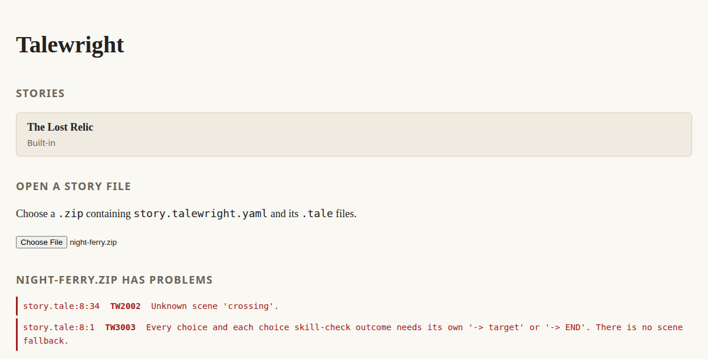
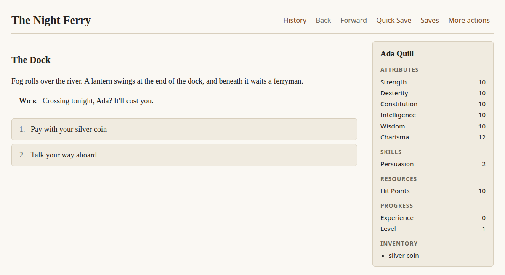

# Your first story

In this tutorial you'll build *The Night Ferry*: a three-scene story with dialogue, an item, a skill
check and text that changes depending on what the player did. It takes about fifteen minutes. You
need a text editor: VS Code with the Talewright extension (see [Getting started](getting-started.md))
or any plain-text editor. Either way, you can play the story in the
[web player](https://play.trytalewright.com/).

> **Want a quick playable starting point?** With the [CLI installed](cli-installation.md), run
> `talewright new night-ferry --title "The Night Ferry"` to create a complete, valid starter story.
> Open that folder in your editor and use `talewright run night-ferry` to play it. To learn how the
> manifest and scenes fit together, continue with the manual walkthrough below.

## 1. Create the story folder

Make a folder called `night-ferry` and open it in your editor. In VS Code, use **File > Open Folder**
and trust the folder you created. A story has two kinds of file: one `story.talewright.yaml` settings
file and one or more `.tale` files for the scenes
([what each file is for](getting-started.md#1-set-up-your-story-folder)).
Inside the folder, create a file called `story.talewright.yaml`:

```yaml
game:
  id: night-ferry
  title: The Night Ferry
  version: 0.1.0
  start: dock
  ruleset: rpg

characters:
  player:
    first-name: Ada
    last-name: Quill
    pronouns: she
    stats: { cha: 12, persuasion: 2 }
    inventory: [coin]
  ferryman:
    first-name: Wick
    pronouns: he

items:
  coin: { name: silver coin }
```

This is your story's **manifest**, the settings file that tells Talewright about your story and its
characters:

- `game.id` is a short, unique name. Lowercase words joined by hyphens are the recommended style.
  `game.title` is what players see.
- `game.start` is the scene the story opens on. You'll write it next.
- `ruleset: rpg` turns on the ready-made RPG rules: stats such as charisma and persuasion, and skill checks.
- `characters` must include `player`. Every other character gets an id you choose, like `ferryman`.
- `stats` sets starting values. Stats you leave out use the defaults (10 for attributes like `cha`,
  0 for skills like `persuasion`). See [the full stat list](writing-stories.md#stats-and-skills).
- `items` declares things characters can carry. The `name` is what players see.

## 2. Write the first scene

Create `story.tale` in the same folder. This is **Talemark**, the story-authoring language
that combines your prose with dialogue, choices, and story logic:

```tale
=== dock
@title The Dock

Fog rolls over the river. A lantern swings at the end of the dock, and beneath it waits a ferryman.

> ferryman: Crossing tonight, {player:first-name}? It'll cost you.

* [Pay with your silver coin] -> crossing
* [Walk away] -> END
```

- `=== dock` starts a scene called `dock`. `@title` gives it a heading.
- Plain lines are prose. `**bold**` and `*italics*` formatting work; backticks are ordinary text.
  Talemark is not Markdown, so other Markdown is not supported.
- `> ferryman:` is a line of dialogue spoken by the `ferryman` character.
- `{player:first-name}` is replaced with the player's name, "Ada".
- Lines starting with `*` are **choices**: the label goes in `[brackets]`, and `->` names the scene to go
  to next. `-> END` ends the story.

## 3. Check it and fix your first error

Save both files. In VS Code, mistakes are underlined as you type; open **View > Problems** to see
them all together. To check the saved story, run **Talewright: Validate Story** from the Command
Palette (**View > Command Palette**, or **Ctrl+Shift+P**). If VS Code says the CLI is missing,
choose **Set Up CLI** and follow the [setup guide](cli-installation.md).

The choice you wrote points at a scene that doesn't exist yet. That's on purpose: this step shows
you how to find and fix a mistake. If you're not using VS Code, either of these does the same check.

### Check in the web player (no install)

Zip the `night-ferry` folder using the instructions in
[No desktop tools? Use the web player](#no-desktop-tools-use-the-web-player) below. Open the zip in
the web player. It checks the story and shows errors instead of opening a story that has mistakes.

### Or, check from a terminal

With the [story tools installed](cli-installation.md), give the tool your story folder's full
location. For example, from the unpacked tools folder on Windows:

```powershell
.\Talewright.Cli.exe validate "C:\Users\<your user>\Documents\night-ferry"
```

Replace `<your user>` or the entire path with your own folder's location. On Mac/Linux, use
`./Talewright.Cli validate "/full/path/to/night-ferry"` from the tools folder.
If you installed the .NET tool instead, its command is `talewright validate`.

The check fails, because the choice points at a `crossing` scene that doesn't exist. Talewright lists
every problem with its file, line and column, so you can go straight to it:

```text
story.tale:8:34: error TW2002: Unknown scene 'crossing'.
story.tale:8:1: error TW3003: Every choice and each choice skill-check outcome needs its own '-> target' or '-> END'. ...
Validation failed.
```

`TW2002` is the real problem. `TW3003` is a domino effect of the same mistake and disappears once you
fix it. When you see several errors, fix the first one and check again. Every code is explained in the
[error code reference](../reference/diagnostics.md).

Add the missing scene to the end of `story.tale`:

```tale
=== crossing
@title The Crossing

The boat slides into the dark.

-> END
```

A `->` line on its own moves on to that scene. When a scene has no choices, the player gets a
**Continue** button, or **The End** when it leads to `END`.

Check again the same way. The command-line tool prints `Validation succeeded.` when there are
no errors; the web player opens the story once it passes its checks.

Now play it. In VS Code, run **Talewright: Run Story** to play it in its own window. Or run
**Talewright: Publish Story ZIP**, save the ZIP somewhere outside the story folder, and open it in
the web player with **Open a story file**. Without VS Code, zip the folder yourself using the steps
below.

The web player doesn't notice your edits: after each change, save, make a fresh ZIP and open it
again. To test one scene without playing from the beginning, use the
[Author Debugger](testing-your-story.md#3-jump-to-any-scene-with-the-author-debugger).

### No desktop tools? Use the web player

Zip the `night-ferry` folder:

- **Windows:** right-click the folder → **Send to** → **Compressed (zipped) folder**.
- **macOS:** right-click the folder → **Compress**.
- **Linux:** right-click → **Compress**, or run `zip -r night-ferry.zip night-ferry`.

Open the [web player](https://play.trytalewright.com/), choose **Open a story file** and pick
`night-ferry.zip`. The player runs the same checks, so the story won't open while there are errors.
Instead, you'll see the same list of problems:



After each change, re-zip the folder, go back to the library and open it again.

## 4. Make choices matter

Right now Ada can pay with a coin she might not have, and nothing changes when she does. Replace the
two choices in `dock` with these:

```tale
* [Pay with your silver coin] (requires player has coin) { take player coin } -> crossing
* [Talk your way aboard] skill-check persuasion dc 12
  success: -> crossing
  failure: -> stranded
```

- `(requires ...)` hides a choice unless its condition is true.
- `{ take player coin }` is an **effect** that changes the game when the choice is picked.
- `skill-check persuasion dc 12` rolls a d20, adds Ada's persuasion bonus, and succeeds on 12 or more.
  The indented `success:` and `failure:` lines say where each result leads.

Add the scene for a failed check:

```tale
=== stranded
@title Stranded

The ferryman pushes off without you. Maybe tomorrow.

-> END
```

## 5. Change the text based on what happened

In `crossing`, replace "The boat slides into the dark." with:

```tale
The boat slides into the dark.
{if player has coin}You keep a hand on your coin the whole way.{else}Your pockets feel lighter.{/if}
```

`{if ...}` shows text only when its condition is true. `{else}` is optional.

Check the story again, then play both routes. The character sheet on the right updates as Ada spends her coin, and
skill check results appear in the story as they happen.



## The finished story

<details>
<summary>Complete <code>story.tale</code></summary>

```tale
=== dock
@title The Dock

Fog rolls over the river. A lantern swings at the end of the dock, and beneath it waits a ferryman.

> ferryman: Crossing tonight, {player:first-name}? It'll cost you.

* [Pay with your silver coin] (requires player has coin) { take player coin } -> crossing
* [Talk your way aboard] skill-check persuasion dc 12
  success: -> crossing
  failure: -> stranded

=== crossing
@title The Crossing

The boat slides into the dark.
{if player has coin}You keep a hand on your coin the whole way.{else}Your pockets feel lighter.{/if}

-> END

=== stranded
@title Stranded

The ferryman pushes off without you. Maybe tomorrow.

-> END
```

</details>

## Where next

- **[Writing stories](writing-stories.md):** factions, hubs, triggers, character creation and more.
- **[Organizing your story](organizing-your-story.md):** keep this simple layout or split related settings into smaller files.
- **[The Lost Relic](../../samples/LostRelic):** a bigger sample that uses almost every feature.
  [Its README](../../samples/README.md) maps each feature to where it's used.
- **[Testing your story](testing-your-story.md):** check your story without playing it, and jump to any scene.
