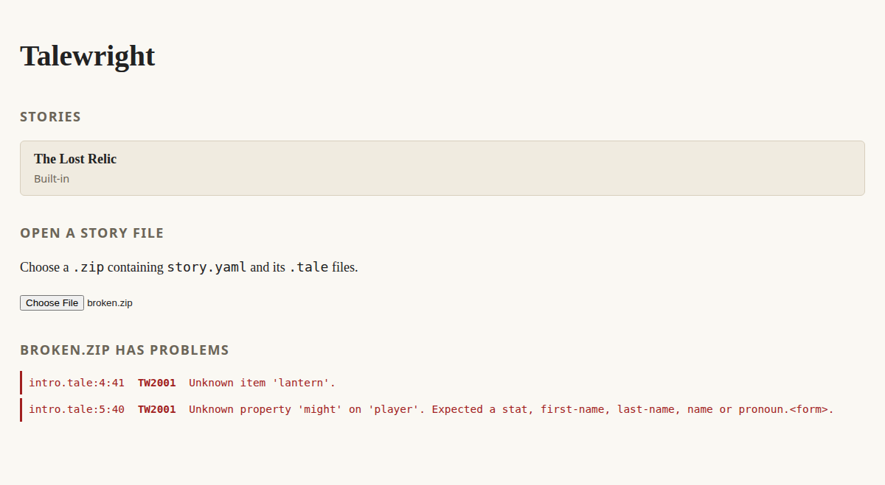
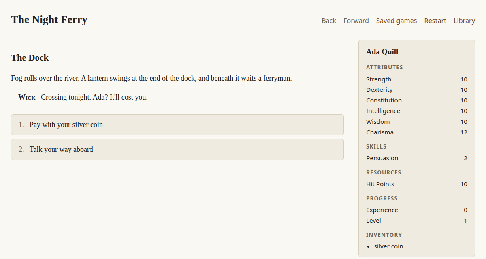

# Your first story

In this tutorial you'll build *The Night Ferry*: a three-scene story with dialogue, an item, a skill
check and text that changes depending on what the player did. It takes about fifteen minutes. You
need a text editor and the [desktop tools](getting-started.md#install-the-desktop-tools); if you don't
have those yet, the [web player](https://squid-farm.github.io/talewright/) works too.

## 1. Create the story folder

Make a folder called `night-ferry`. Inside it, create a file called `story.talewright.yaml`:

```yaml
id: night-ferry
title: The Night Ferry
version: 0.1.0
start: dock

characters:
  player:
    first-name: Ada
    last-name: Quill
    pronouns: she
    stats: { cha: 12, persuasion: 2 }
    inventory: [coin]
  ferryman:
    first-name: Wick
    pronouns: he

items:
  coin: { name: silver coin }
```

This is your story's **manifest**:

- `id` is a short, unique name (lowercase words joined by hyphens). `title` is what players see.
- `start` is the scene the story opens on. You'll write it next.
- `characters` must include `player`. Every other character gets an id you choose, like `ferryman`.
- `stats` sets starting values. Stats you leave out use the defaults (10 for attributes like `cha`,
  0 for skills like `persuasion`). See [the full stat list](writing-stories.md#stats-and-skills).
- `items` declares things characters can carry. The `name` is what players see.

## 2. Write the first scene

Create `story.tale` in the same folder. This is **Talemark**, the story-authoring language
that combines your prose with dialogue, choices, and story logic:

```tale
=== dock
@title The Dock

Fog rolls over the river. A lantern swings at the end of the dock, and beneath it waits a ferryman.

> ferryman: Crossing tonight, {player:first-name}? It'll cost you.

* [Pay with your silver coin] -> crossing
* [Walk away] -> END
```

- `=== dock` starts a scene called `dock`. `@title` gives it a heading.
- Plain lines are prose. Markdown like `**bold**` and `*italics*` works.
- `> ferryman:` is a line of dialogue spoken by the `ferryman` character.
- `{player:first-name}` is replaced with the player's name, "Ada".
- Lines starting with `*` are **choices**: the label goes in `[brackets]`, and `->` names the scene to go
  to next. `-> END` ends the story.

## 3. Check it and fix your first error

Before you play, have Talewright check the story. It finds mistakes in seconds, so it's worth making a
habit of it. The same tool also runs the [Author Debugger](testing-your-story.md#3-jump-to-any-scene-with-the-author-debugger),
which lets you jump straight to any scene.

Open a terminal in the Talewright folder and run this, replacing `path/to/night-ferry` with
wherever you made the folder:

```bash
talewright validate path/to/night-ferry
```

> Need the tool? [Install the desktop tools](getting-started.md#install-the-desktop-tools) first; it
> takes a few minutes. Until ready-made downloads arrive, type `dotnet run --project tooling/cli/src/Talewright.Cli --`
> in place of `talewright`. Not ready for that yet? [Use the web player](#no-desktop-tools-use-the-web-player)
> instead.

The check fails, because the choice points at a `crossing` scene that doesn't exist. Talewright lists
every problem with its file, line and column, so you can go straight to it:

```text
story.tale:8:34: error TW2002: Unknown scene 'crossing'.
story.tale:1:1: error TW3003: Scene 'dock' has a choice or check outcome without '-> target', ...
Validation failed.
```

`TW2002` is the real problem. `TW3003` is a domino effect of the same mistake and disappears once you
fix it. When you see several errors, fix the first one and check again. Every code is explained in the
[error code reference](../reference/diagnostics.md).

Add the missing scene to the end of `story.tale`:

```tale
=== crossing
@title The Crossing

The boat slides into the dark.

-> END
```

A `->` line on its own moves on to that scene. When a scene has no choices, the player gets a
**Continue** button, or **The End** when it leads to `END`.

Check again, and this time you'll see `Validation succeeded.` Now play it. The desktop player opens the
folder directly, with no zipping:

```bash
dotnet run --project apps/desktop -- path/to/night-ferry
```

You can play from start to finish. After each change, choose **Library** and open the story again; it
reads your files fresh each time.

### No desktop tools? Use the web player

Zip the `night-ferry` folder:

- **Windows:** right-click the folder → **Send to** → **Compressed (zipped) folder**.
- **macOS:** right-click the folder → **Compress**.
- **Linux:** right-click → **Compress**, or run `zip -r night-ferry.zip night-ferry`.

Open the [web player](https://squid-farm.github.io/talewright/), choose **Open a story file** and pick
`night-ferry.zip`. The player runs the same checks, so the story won't open while there are errors.
Instead, you'll see the same list of problems:



> This screenshot shows two other common mistakes: an item that was never declared in `story.talewright.yaml`,
> and a misspelled stat.

After each change, re-zip the folder, go back to the library and open it again.

## 4. Make choices matter

Right now Ada can pay with a coin she might not have, and nothing changes when she does. Replace the
two choices in `dock` with these:

```tale
* [Pay with your silver coin] (requires: player has coin) { take player coin } -> crossing
* [Talk your way aboard] skill-check persuasion dc 12
  success: -> crossing
  failure: -> stranded
```

- `(requires: ...)` hides a choice unless its condition is true.
- `{ take player coin }` is an **effect** that changes the game when the choice is picked.
- `skill-check persuasion dc 12` rolls a d20, adds Ada's persuasion bonus, and succeeds on 12 or more.
  The indented `success:` and `failure:` lines say where each result leads.

Add the scene for a failed check:

```tale
=== stranded
@title Stranded

The ferryman pushes off without you. Maybe tomorrow.

-> END
```

## 5. Change the text based on what happened

In `crossing`, replace "The boat slides into the dark." with:

```tale
The boat slides into the dark.
{if player has coin}You keep a hand on your coin the whole way.{else}Your pockets feel lighter.{/if}
```

`{if ...}` shows text only when its condition is true. `{else}` is optional.

Check the story again, then play both routes. The character sheet on the right updates as Ada spends her coin, and
skill check results appear in the story as they happen.



## The finished story

<details>
<summary>Complete <code>story.tale</code></summary>

```tale
=== dock
@title The Dock

Fog rolls over the river. A lantern swings at the end of the dock, and beneath it waits a ferryman.

> ferryman: Crossing tonight, {player:first-name}? It'll cost you.

* [Pay with your silver coin] (requires: player has coin) { take player coin } -> crossing
* [Talk your way aboard] skill-check persuasion dc 12
  success: -> crossing
  failure: -> stranded

=== crossing
@title The Crossing

The boat slides into the dark.
{if player has coin}You keep a hand on your coin the whole way.{else}Your pockets feel lighter.{/if}

-> END

=== stranded
@title Stranded

The ferryman pushes off without you. Maybe tomorrow.

-> END
```

</details>

## Where next

- **[Writing stories](writing-stories.md):** factions, hubs, triggers, character creation and more.
- **[The Lost Relic](../../samples/LostRelic):** a bigger sample that uses almost every feature.
  [Its README](../../samples/README.md) maps each feature to where it's used.
- **[Testing your story](testing-your-story.md):** check your story without playing it, and jump to any scene.
