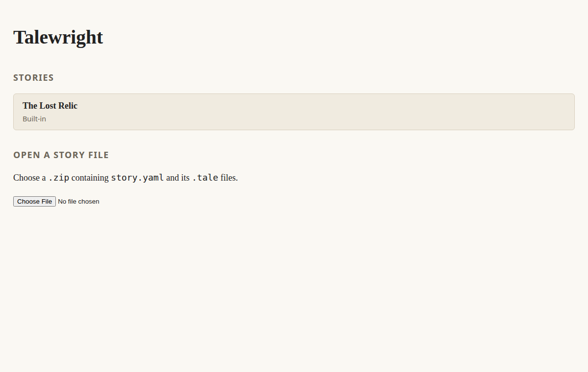

# Getting started

Talewright stories are folders of text files. Write in **Talemark**, check your changes, then
play the story and share it. We recommend VS Code with the Talewright extension for writing help.
You can also use any plain-text editor and the browser player.

## Set up your editor

The current Talewright extension supports **Linux computers with Intel or AMD 64-bit processors
(Linux x64)**. It is tested on Ubuntu 24.04 and Linux Mint 22.3. Windows, Mac, Linux ARM and
browser-hosted VS Code are not supported by this extension release. On those systems, use a
plain-text editor and the browser player, or the separate story tools described below.

1. Install [VS Code](https://code.visualstudio.com/).
2. In **Extensions**, install **Talewright** by **squid-farm** from
   [the Marketplace](https://marketplace.visualstudio.com/items?itemName=squid-farm.talewright).
   Choose **Switch to Pre-Release Version** for preview releases.
3. Install [YAML by Red Hat](https://marketplace.visualstudio.com/items?itemName=redhat.vscode-yaml)
   for help with the story settings file.
4. Open your story folder using **File > Open Folder**. It should contain
   `story.talewright.yaml` and your `.tale` files.
5. Trust the folder if it is your own story or you trust its source. Open a `.tale` file;
   the language indicator should say **Talemark**.

The extension highlights your writing, suggests story names and reports mistakes as you edit.
Its live-checking tool, called the **language server**, is included: you do not need to install
.NET or build Talewright. Save your changes before checking or playing the files on disk.
The [extension guide](../../tooling/vscode-talewright/README.md) includes a download-and-install
alternative and system requirements.

## Optional: install the desktop tools

For checks without opening the player, making story ZIPs, or testing individual scenes, run
**Talewright: Set Up CLI** from VS Code's Command Palette (**Ctrl+Shift+P**).
It uses an existing installation when available. Otherwise, it offers a portable download or,
when the required .NET tools are installed, asks for approval to install the CLI.
Nothing is installed just by opening a story.

The CLI is a separate command-line tool; installing the extension does not install it.
Follow [Get the story-checking tools](cli-installation.md) to select an extracted download or
set up the tool without VS Code. Windows, Mac and Linux downloads exist; only Linux x64 execution
has been verified so far. The native **Author Debugger** also needs your computer's web-viewing
components. Making a separate website or desktop game still requires the .NET 10 SDK.

After setup, the Command Palette offers:

- **Talewright: Validate Story** to check saved files.
- **Talewright: Publish Story ZIP** to choose where to save story files for a player.
- **Talewright: Open Author Debugger** to jump to a scene and test choices and state.

These are not a Play button or VS Code's F5 debugger. To play from the beginning, open a story
ZIP in the browser player. The Author Debugger is a separate testing window.

## What goes in a story folder?

Start with two files:

```text
my-story/
  story.talewright.yaml
  story.tale
```

`story.talewright.yaml` holds the title, starting scene, characters and rules.
Your `.tale` files hold scenes, dialogue and choices. As your story grows, you can add more
files and subfolders. [Your first story](first-story.md) provides the complete starting text.

## Use another editor and the browser player

Any editor that saves plain text works. On Mac, use TextEdit's plain-text mode.
Write your story, save the files, zip the story folder and open the
**[Talewright web player](https://squid-farm.github.io/talewright/)**.



- Pick **The Lost Relic** to try a sample.
- Choose **Open a story file** to check and play your own ZIP.

The player reads the ZIP on your computer; it does not upload it or edit your source files.
After making changes, create a fresh ZIP and open it again. It does not automatically refresh
from your editor. See the [ZIP instructions](first-story.md#no-desktop-tools-use-the-web-player).

Send that same ZIP to friends to play in the browser. It contains your story, not a separate
website or app. A ready-to-use general-purpose desktop player is not included in the CLI download.

## Next

[Write your first story →](first-story.md)
