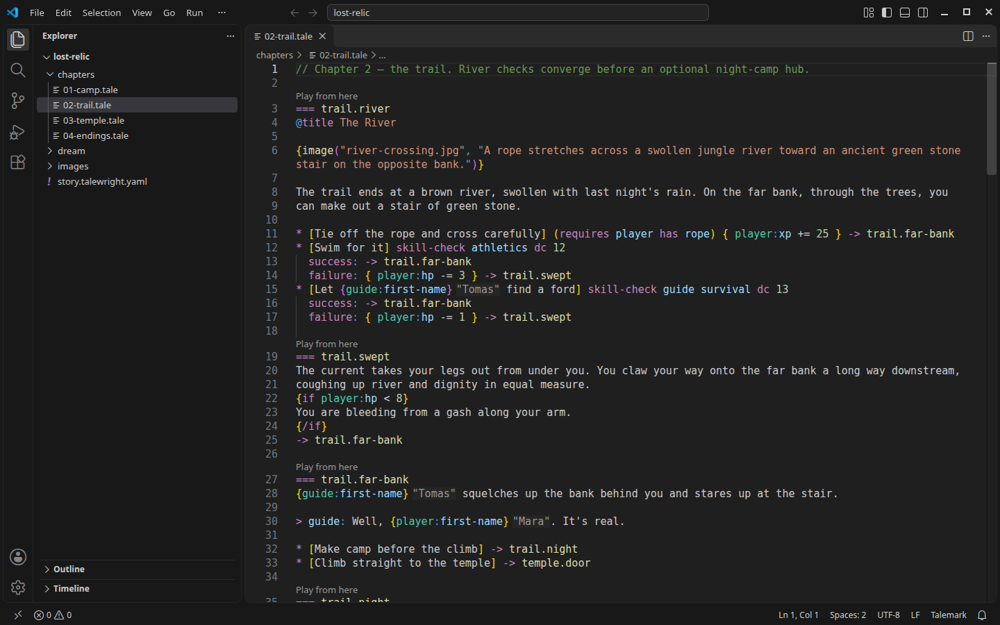
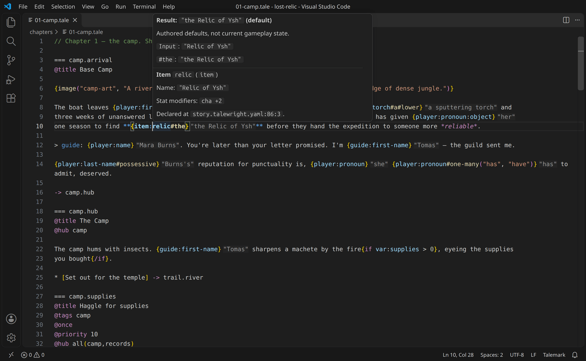
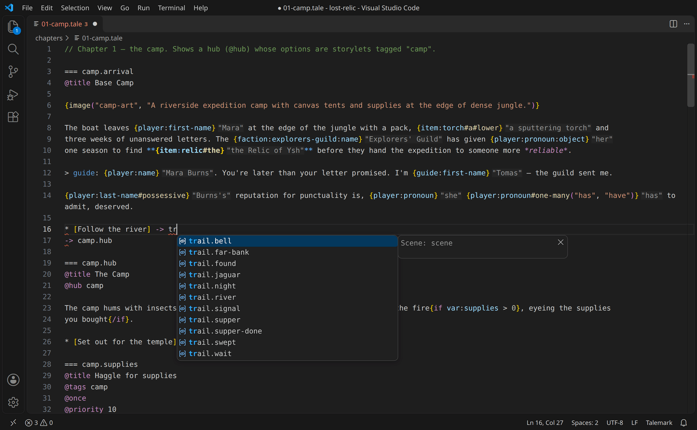
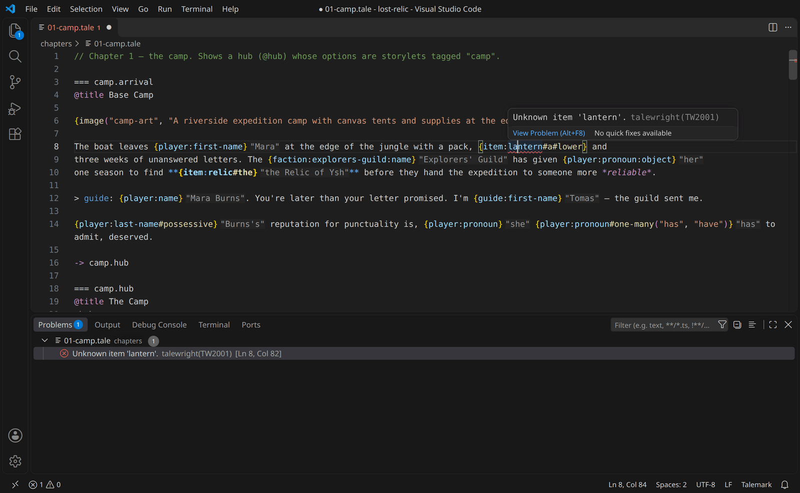
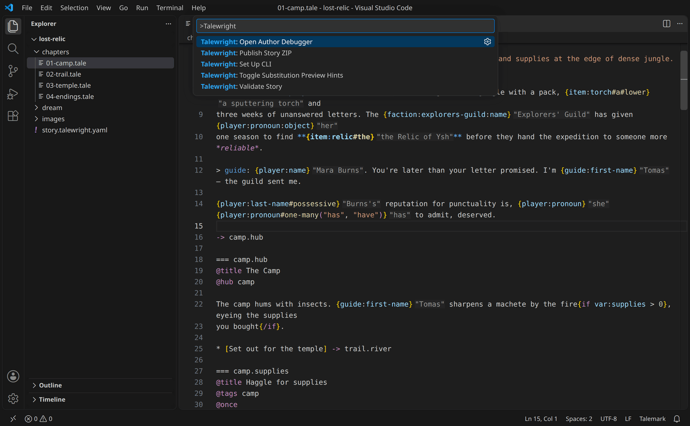
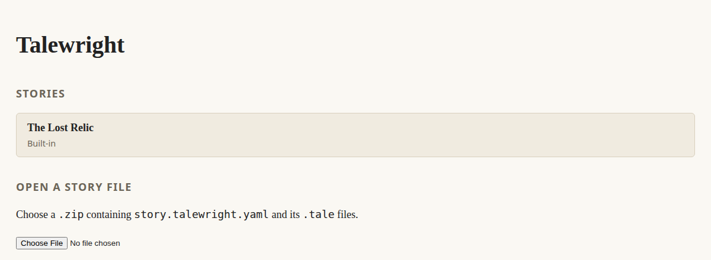

# Getting started

A Talewright story is a folder of plain-text files. You write it in **Talemark**, check it for
mistakes, play it, and share it. We recommend VS Code with the Talewright extension, which helps
as you type, but any plain-text editor and the browser player work too. If a term is unfamiliar,
see the [glossary](../reference/glossary.md).

## 1. Set up your story folder

**Fastest start:** if you have the [CLI installed](cli-installation.md), run `talewright new my-story`
in a terminal. It creates a small story that's ready to play; open the new folder in your editor.
See the [CLI reference](../reference/cli.md#new) for options.

Or make the folder yourself. Each story lives in its own folder. Make one somewhere easy to find,
such as **Documents > talewright > my-story**, with two files inside:

```text
my-story/
  story.talewright.yaml
  story.tale
```

- **`story.talewright.yaml`** is your story's settings file, also called the **manifest**. It holds
  the title, the starting scene, the characters, items and rules. Every story has exactly one.
  It is written in **YAML**, a simple format of `name: value` lines where indentation shows
  what belongs to what.
- **`.tale` files** hold the story itself: scenes, prose, dialogue and choices, written in
  **Talemark**. Start with one `story.tale`. As your story grows, you can add more `.tale` files
  and subfolders; Talewright reads all of them.

Make sure your editor doesn't add `.txt` to the end of either name.
[Your first story](first-story.md) gives you the text to put in both files.

## 2. Set up your editor

1. Install [VS Code](https://code.visualstudio.com/).
2. In **Extensions**, install **Talewright** by **squid-farm** from
   [the Marketplace](https://marketplace.visualstudio.com/items?itemName=squid-farm.talewright).
   Choose **Switch to Pre-Release Version** to get preview releases.
3. Install [YAML by Red Hat](https://marketplace.visualstudio.com/items?itemName=redhat.vscode-yaml)
   for help with the settings file.
4. Open your story folder with **File > Open Folder**.
5. When VS Code asks whether you trust the authors of the files in this folder, choose
   **Yes, I trust the authors** if it's your own story or you trust where it came from. Live checks
   only run in trusted folders. Open a `.tale` file; the bottom-right corner should say **Talemark**.

> **Which computers?** Talewright is tested on Linux computers with Intel or AMD processors.
> Downloads for Windows, Mac and Linux ARM are available too, but haven't been tried on those
> computers yet. If something doesn't work on yours, please
> [tell us](troubleshooting.md#still-stuck). Browser-based VS Code and Alpine Linux aren't
> supported; use a plain-text editor and the browser player instead.

The extension highlights your writing, suggests names from your story and points out mistakes as
you type. Nothing else needs installing for this.



Grey previews after each `{...}` substitution show the text players will see, using your story's
starting values. Hover over a substitution to see how its text was produced, plus details such as
an item's stat bonuses and where it is declared:



Start typing a scene, item or other name to get suggestions from your own story:



Mistakes are underlined as you type and listed in the **Problems** panel with their line number:



The [extension guide](../../tooling/vscode-talewright/README.md) has more detail, including how to
install the extension from a download.

### Finding the Command Palette

Talewright's actions live in VS Code's **Command Palette**, a search box for every command. Open it
with **View > Command Palette**, or press **Ctrl+Shift+P** (**Cmd+Shift+P** on Mac). A box appears
at the top of the window. Type `Talewright` to list the Talewright actions, then choose one.



## 3. Get the story-checking tools (CLI)

The **Talewright CLI** checks your saved story, plays it, makes story ZIPs to share and opens the
**Author Debugger** so you can test any scene. It is a separate download from the extension.

- **In VS Code:** open the Command Palette and run **Talewright: Set Up CLI**. It uses the CLI if
  you already have it. Otherwise it offers a download, or asks before installing the CLI if you have
  the .NET tools. Nothing is installed just by opening a story.
- **Without VS Code:** [Get the story-checking tools](cli-installation.md) walks you through the
  download step by step.

Once it's set up, the Command Palette offers:

- **Talewright: Validate Story** to check your saved files.
- **Talewright: Run Story** to play the story from the beginning in its own window.
- **Talewright: Open Author Debugger** to jump to any scene and test choices and game state.
- **Talewright: Publish Story ZIP** to save a story file you can share.

**Run Story** needs the [.NET 10 Runtime](#which-net-version-do-i-need). The Author Debugger and
Run Story open separate windows; they aren't VS Code's F5 debugger. On Linux they need the
[desktop setup](#linux-desktop-setup) below.

## Linux desktop setup

On Linux, the desktop player, the Author Debugger and published desktop games need two system
libraries, **WebKitGTK 4.1** and **libnotify**, and a graphical desktop (X11 or Wayland).
Talewright doesn't install these for you, and published games don't check for them before they
start.

Open a terminal and run the command for your system. It may ask for your password:

**Debian, Ubuntu and Linux Mint:**

```bash
sudo apt install libwebkit2gtk-4.1-0 libnotify4
```

**Fedora:**

```bash
sudo dnf install webkit2gtk4.1 libnotify
```

**Arch Linux:** after updating your system:

```bash
sudo pacman -S webkit2gtk-4.1 libnotify
```

On other systems, look for packages that provide `libwebkit2gtk-4.1.so.0` and `libnotify.so.4`.
A WebKitGTK 4.0 or GTK 4 package won't work instead.

The [web player](https://play.trytalewright.com/) and published web games run in your browser and
don't need these libraries.

## Which .NET version do I need?

Most authors don't need .NET at all.

| What you are doing | What you need |
|---|---|
| Writing with the VS Code extension, or playing in a browser | Nothing extra. |
| Using the CLI download, including the Author Debugger | Nothing extra; the download includes what it needs. |
| **Talewright: Run Story** in VS Code | The .NET 10 Runtime. |
| Installing the CLI as a .NET tool | The .NET 10 SDK. |
| Making a standalone website or desktop game | The .NET 10 SDK (10.0.100 or later) and an internet connection. |
| Playing a published desktop game | Nothing extra; the game includes what it needs. |

If you need the SDK, install the [.NET 10 SDK](https://dotnet.microsoft.com/download/dotnet/10.0);
it includes the runtime. To see what's already installed, run:

```bash
dotnet --list-sdks
dotnet --list-runtimes
```

Look for a `10.0.x` SDK or a `Microsoft.NETCore.App 10.0.x` runtime. If `dotnet` isn't found, it
isn't installed (or isn't on your PATH).

## Use another editor and the browser player

Any editor that saves plain text works. On a Mac, use TextEdit's plain-text mode. Write your story,
save the files, zip the story folder and open the
**[Talewright web player](https://play.trytalewright.com/)**.



- Pick **The Lost Relic** to try a sample.
- Choose **Open a story file** to check and play your own ZIP.

The player reads the ZIP on your computer; it doesn't upload it or change your files. It also
doesn't notice later edits: after a change, make a fresh ZIP and open it again. See the
[ZIP instructions](first-story.md#no-desktop-tools-use-the-web-player).

You can send that same ZIP to friends to play in their browser.

## Next

[Write your first story →](first-story.md)
