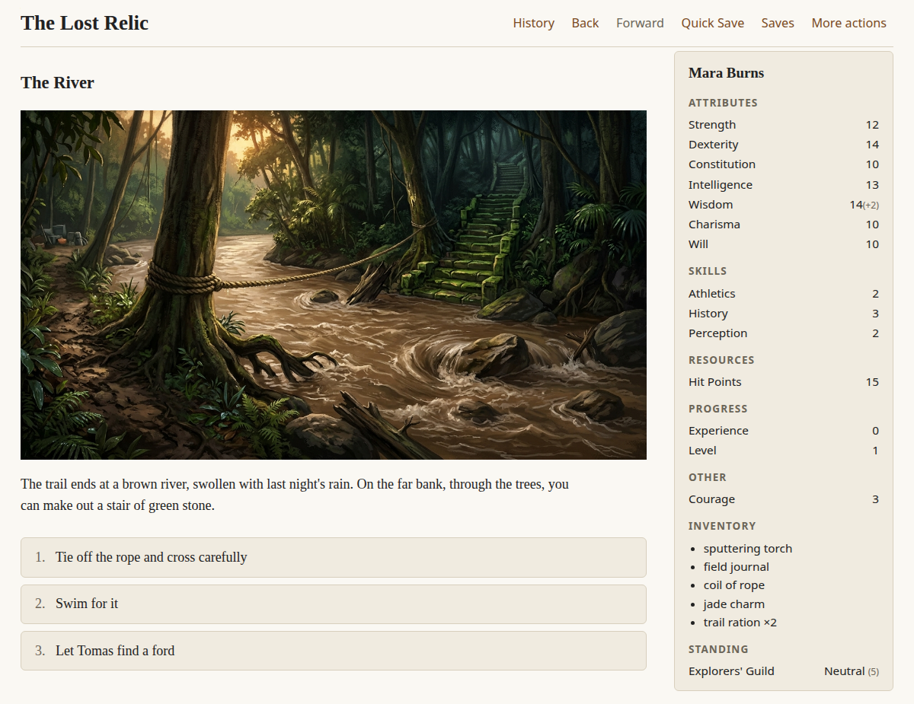
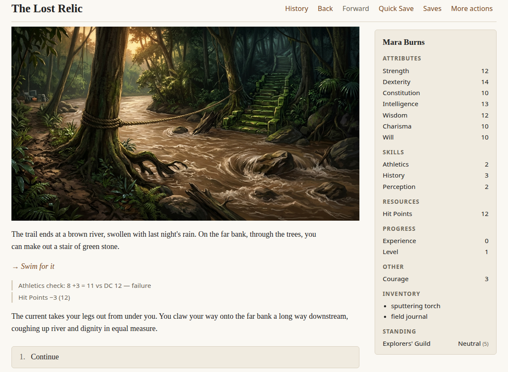

# Playing and saving

The web player, the desktop player and published games all share the same screen. This page shows
what your players see and what they can do.

## The screen

- **Story text** builds up as you play. Earlier scenes stay visible above the current one, and past
  choices are shown as `→ Choice`. A scene marked `@clear` starts a fresh screen, but earlier
  passages remain available in **History** and saves. Earlier pictures stay visible unless a later
  scene repeats the same image file. Only those older copies collapse into **Reveal image** controls.
  A scene marked `@continues` counts as part of the scene it continues.
- **Choices** are the numbered buttons at the bottom. Choices whose requirements aren't met are hidden,
  unless the author chose to show them.
- **Notes** appear in the story when something happens to the player: skill check rolls, stat and
  standing changes, XP gained.
- **The character sheet** shows the player's stats, skills (only those above 0), inventory and faction
  standings. Stats boosted by an item show the bonus. A story shows only the sections it uses, and its
  author can hide some or all of the sheet.

## The toolbar

| Button | What it does |
|---|---|
| **History** | Read earlier passages and choices without changing your playthrough. |
| **Back** / **Forward** | Step through your choices, like undo and redo. Picking a different choice after going back starts a new path. Authors can hide these with `game.undo: false`. |
| **Quick Save** | Save to this story's one quick-save slot, replacing the last quick save. Named saves are never replaced. |
| **Saves** | Create, load, export or import saves. Replacing a named save asks you to confirm. |
| **More actions → Settings** | Theme, text size, reading width, line spacing, reduced motion, and whether to show mechanical notes. These settings apply to every story on this device. |
| **More actions → Restart** | Start again from the beginning, after confirming. Your saves are kept. |
| **More actions → Library** | Go back to the list of stories (not shown in published games). |

A few notes on the settings:

- **Text size** applies to everything in the player and works alongside browser zoom.
- **Reading width** and **line spacing** apply to the story text and History.
- **Reduced motion** follows your computer's setting unless you choose **Reduce**, which turns off
  animations and shows new passages instantly. Stories can't override it.
- **Hiding mechanical notes** only changes what's displayed (including for screen readers). The game,
  its history and saves are unchanged.

The toolbar stays visible while you scroll.

### Reading earlier passages

The main view keeps only recent passages on screen. Earlier text and your choices are always
available through **History**, even if the author turned off Back and Forward. History opens on the
newest page; use **Earlier passages** and **Later passages** to move through it. Past choices are
shown as text, not buttons, and reading History never changes your game.

If a save continues after a story update, passages from before the update still show the text and
choices as they were played. **Back** stops at the point where the updated story continued.

To save memory, pictures in History stay hidden until you choose **Reveal image**. If the story's
image files changed since you played, a revealed picture may look different or fail to load.
Revealed pictures appear inline at their normal size, fitted to the reading width, without a
separate scroll box.

Use **Return to play**, or press **History** again, to go back to where you were. You can't choose,
save, load or restart while History is open.

## Saves

The **Saves** dialog lists the newest saves first, each with its name, scene, time and character.
A story can have several kinds of save:

- **Named saves:** as many as you like. Create one whenever you want to keep a point in the story.
- **Quick Save:** one slot per story. Each Quick Save replaces the last one.
- **Autosave:** one recovery slot, updated after every choice (see below).
- **Trigger checkpoint:** one slot, written when a [trigger](writing-stories.md#triggers) marked
  `save: true` fires. It's labeled with the trigger's ID, and the next saving trigger replaces it.

Before loading a save, the player asks **Load save** or **Keep playing** if your current progress
isn't saved anywhere. A failed load or save leaves your current game and your existing saves as
they were; follow the advice shown and try again. Restarting or reopening the player keeps all
your saves.

### Autosave

Autosave is on unless the author sets `game.autosave: false` in `story.talewright.yaml`. Turning it
off stops new autosaves but keeps any existing one, and doesn't affect the other kinds of save.

With autosave on, Talewright saves at the start of the story and after every choice. When you
reopen the story, you choose **Resume saved game** or **Start a new game**; it never resumes
without asking. The **Autosave** entry also appears in the Saves list so you can load it at any
time. You can't overwrite it yourself, and your next choice replaces it.

If an autosave fails, you can keep playing; choose **Retry autosave** when you're ready. If an old
autosave can't be loaded and you start a new game, Talewright keeps a copy as **Recovered autosave**
in your Saves list first. It may load with the earlier version of the story.

## Where saves are kept

| Player | Location |
|---|---|
| Web | In your browser, for that website only. Clearing site data deletes them, and they don't sync between browsers or devices. |
| Desktop (Windows) | `%LOCALAPPDATA%\Talewright\saves` |
| Desktop (macOS) | `~/Library/Application Support/Talewright/saves` |
| Desktop (Linux) | `~/.local/share/Talewright/saves` |

### Backing up and moving saves

Open **Saves** and choose **Export** beside a named save or the Quick Save. The web player downloads
a `.twsave` file; the desktop player asks where to save it. Keep the file somewhere safe before
clearing browser data or moving to another device. Save files work in both the web and desktop
players.

To restore a backup, open the same story, type a **Save name**, then choose the file under
**Import save file**. If that name is already used, you'll be asked before it's replaced. The
import becomes a new named save; choose **Load** to play it. A damaged file, or one from a
different story, is rejected without touching your other saves.

Save files aren't meant to be edited; changing one can break it.

## Updating a story with existing saves

Current saves first try to replay the playthrough in the updated story. If an earlier choice or
check has changed so it cannot be replayed, the player can continue from the saved checkpoint at
the current passage instead. The updated passage uses the new story's entry effects, checks, text
and choices. Your saved character and game values carry over; changed starting values do not reset
them, and newly added values use their current defaults. Effects from choices already made are not
applied again, and changes to earlier passages do not change what already happened.

The player keeps earlier passages in **History** as they were originally played. Continuing from
a checkpoint starts a new undo boundary: **Back** and **Forward** cannot cross it, and choices
that had been undone are discarded. The player shows a notice when a save continues this way.

Some updates cannot continue a save. For example, the saved target scene may have been removed, a
variable may have changed between a number and text, or the saved character may no longer be valid.
In those cases the player says, “This save cannot continue in the updated story because … Open it
with the story version that created it.” The failed load leaves your current game and save file
untouched.

Saves made before checkpoint continuation was introduced, including format-4 saves, keep the old
replay-only behavior: they load only when the updated story can replay their saved history. If the
history no longer matches, the save remains unchanged and can still be opened with the earlier
story version. Keep a copy of each version you release; exporting a save backs it up but does not
make it compatible with a changed story.

The [save format notes](../developer/save-format.md#compatibility) have the exact rules.

The story format itself is still changing between preview releases, so saves from one preview of
Talewright may not load in the next. Starting with 1.0.0-preview.1, saves will keep loading in later
1.x players.

## Character creation

If the story has a [`creation`](writing-stories.md#character-creation) section, players first choose
their name, pronouns, a preset and starting stats. Pronoun choices show the full forms, such as
**she/her/herself** or **they/them/themselves**, depending on which sets the author offers.
**Use default name** restores the author's name. Restart keeps the created character. Loading a
save switches to the character in that save.

## Very long playthroughs

There is no limit on how many choices a playthrough can contain. Very long playthroughs take longer
to save and to load: at 100,000 choices, loading a save can take seconds on desktop and longer in a
browser. Save files are only rejected when they are implausibly large (over 512 MiB compressed or
1 GiB decoded), which protects against damaged files. A browser can also run out of storage space
before that; the player reports the storage error and you can keep playing.
