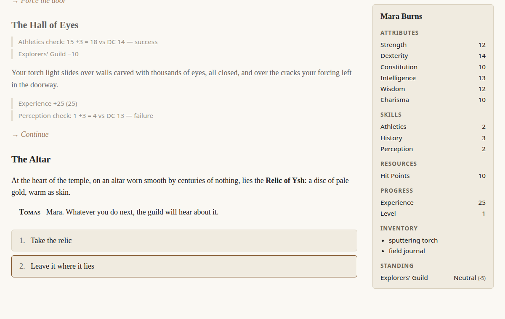
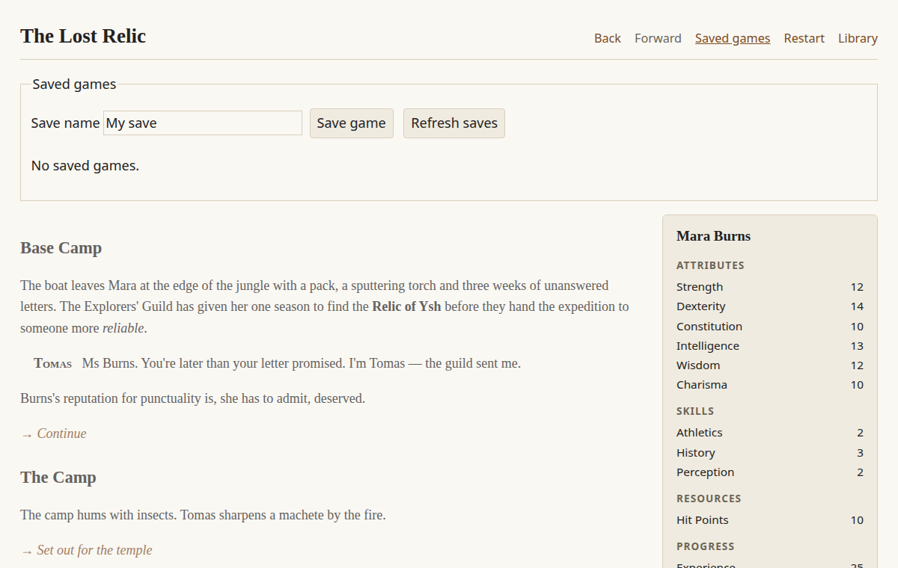

# Playing and saving

The web player, the desktop player and published games all share the same screen.

## The screen

- **Story text** builds up as you play. Earlier scenes stay visible above the current one, and your
  past choices are shown as `→ Choice`.
- **Choices** are the numbered buttons at the bottom. Choices whose requirements aren't met are hidden.
- **Notes** appear inline when something happens to the player: skill check rolls, stat and standing
  changes, XP gained.
- **The character sheet** shows the player's stats, skills (only those above 0), inventory and faction
  standings. Stats boosted by an item show the bonus.

## The toolbar

| Button | What it does |
|---|---|
| **Back** / **Forward** | Step through your choices, like undo and redo. Picking a different choice after going back starts a new path. Authors can hide these with `undo: false`. |
| **Saved games** | Save to a named slot, or load one. Saving over an existing slot asks you to confirm. |
| **Restart** | Start again from the beginning. Your saves are kept. |
| **Library** | Return to the list of stories. |

## Where saves are kept

| Player | Location |
|---|---|
| Web | In your browser, for that website only. Clearing site data deletes them, and they don't sync between browsers or devices. |
| Desktop (Windows) | `%LOCALAPPDATA%\Talewright\saves` |
| Desktop (macOS) | `~/Library/Application Support/Talewright/saves` |
| Desktop (Linux) | `~/.local/share/Talewright/saves` |

There's no autosave yet ([#54](https://github.com/squid-farm/talewright/issues/54)), so save before
closing the player.

## Updating a story with existing saves

Saves are tied to the exact story files they were made with. **Any change to the story, even fixing a
typo, means older saves won't load.** Talewright checks before loading, shows a message and leaves the
current game untouched. Bear this in mind before releasing an update to players. Migrating old saves to
new story versions is planned ([#39](https://github.com/squid-farm/talewright/issues/39)).

## Character creation

If the story has a [`creation`](writing-stories.md#character-creation) section, players first choose
their name, pronouns, preset and starting stats. **Use default name** restores the author's name.
Restart keeps the created character. Loading a save switches to the character in that save.

## Very long playthroughs

After 10,000 choices in one playthrough, the player stops accepting new choices and explains why.
Saving, Back, Restart and Library still work.
