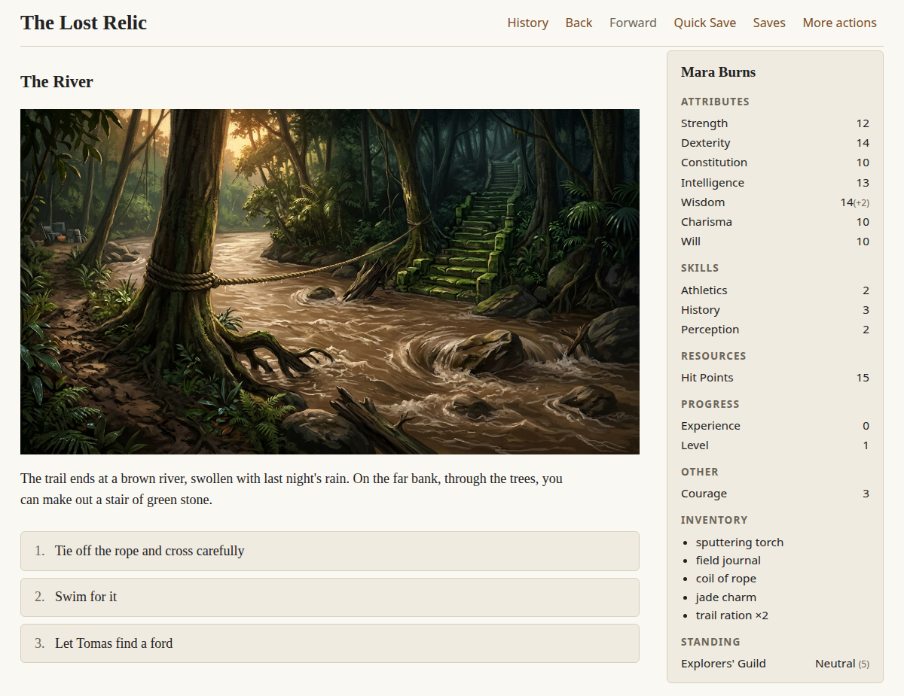
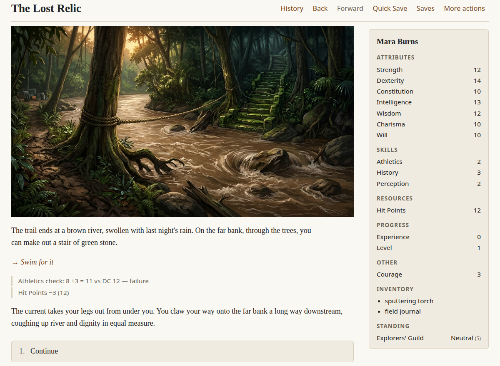

# Playing and saving

The web player, the desktop player and published games all share the same screen.

## The screen

- **Story text** builds up as you play. Earlier scenes stay visible above the current one, and your
  past choices are shown as `→ Choice`.
- **Choices** are the numbered buttons at the bottom. Choices whose requirements aren't met are hidden.
- **Notes** appear inline when something happens to the player: skill check rolls, stat and standing
  changes, XP gained.
- **The character sheet** shows the player's stats, skills (only those above 0), inventory and faction
  standings. Stats boosted by an item show the bonus.

## The toolbar

| Button | What it does |
|---|---|
| **History** | Read earlier recorded passages and choices without changing your playthrough. |
| **Back** / **Forward** | Step through your choices, like undo and redo. Picking a different choice after going back starts a new path. Authors can hide these with `game.undo: false`. |
| **Quick Save** | Write or replace this story's one quick checkpoint, without an overwrite prompt. Named saves are never replaced by this action. |
| **Saves** | Open the Saves dialog to create, load, export or import a save. Replacing an existing named save asks you to confirm. |
| **More actions → Settings** | Choose a theme, text size, reading width (narrow / normal / wide) and line spacing (compact / normal / relaxed), and hide mechanical notes. These preferences are saved on this device and apply across stories. |
| **More actions → Restart** | Confirm starting again from the beginning. Your saves are kept. |
| **More actions → Library** | Return to the list of stories (not shown in published games). |

Text size applies throughout the player, including the toolbar, story, choices, character sheet,
dialogs and diagnostics. It works alongside browser zoom; the desktop setting does not depend on
browser zoom.

Reading width and line spacing apply to the story transcript and recorded history. They work
alongside text size and adapt to the available window width.

When mechanical notes are hidden, they are removed from both the display and accessibility tree.
This changes presentation only; story events, game state, history and saves are unchanged.

Player saves store the story identity/version, seed, choice history and current position, character
selection, compact outcome identities and replay evidence—not a recorded event log or dice results.
Loading replays the saved outcomes with the saved seed, rebuilding the playthrough. **Back** and
**Forward** use those same identities. This differs from folding an existing event log to reconstruct
state; that is an engine operation, not how player saves are restored.

The toolbar stays visible while you scroll. Quick Save confirmations and storage errors appear
in the toolbar without returning you to the start of the passage.
The Saves dialog refreshes automatically when opened and lists the newest saves first.
Each new save shows its name, scene title, save time in your local time zone and character name.
If saved details cannot be read, the dialog marks them unavailable rather than inventing a timestamp.
Each story has its own Quick Save checkpoint. Saving again replaces only that checkpoint; use named
saves to keep multiple points in the story.
A story can also keep one **Trigger checkpoint** when an author marks a trigger with `save: true`.
It is labeled with the trigger ID and appears separately from Autosave, Quick Save and named saves.
The next saving trigger replaces it, even when it has a different ID. If multiple saving triggers fire
in one step, they produce one checkpoint labeled by the last saving trigger to fire. This
checkpoint is independent of whether autosave is enabled.

### Reading earlier passages

Main play keeps only a recent window of passages on screen. Earlier text and your
recorded choices are still available through **History**, even when the author
has disabled Back/Forward. History opens on the newest page; use **Earlier passages**
and **Later passages** to read the rest. Historical choices are text, not buttons.
Reading does not undo choices, reroll checks or run story effects.

History pictures stay unloaded until you activate **Reveal image**, which includes
the image description. **Hide image**, changing pages and leaving History release
that occurrence. A picture still used in main play remains available there.
Revealing an image again can read its file again; edited or missing files may
therefore look different or show a failure message.

Use **Return to play**, or press **History** again, to return to your prior reading
position with focus on the History button. Story-changing controls are unavailable
while History is open; return to play before choosing, saving, loading or restarting.
History pages are not remembered across restart, load, or leaving for the Library.
This limits on-screen content and image lifetimes, not the complete playthrough or
all browser memory. Saves and undo/redo history are not shortened.

Loading asks **Load save** or **Keep playing** only if your current progress is not safely saved.
This includes undo/redo history and your character, not just the visible passage.
Cancel keeps your current game; a failed load also leaves it untouched.
Use **Close saves** or Escape to return to play. If storage fails, check the displayed advice and
use **Retry save list**; a failed save does not count as saved progress.
If Quick Save fails, the previous checkpoint is kept: follow the storage advice and try
**Quick Save** again. Restarting or reopening the player keeps autosave, Quick Save and named saves.

## Where saves are kept

| Player | Location |
|---|---|
| Web | In your browser, for that website only. Clearing site data deletes them, and they don't sync between browsers or devices. |
| Desktop (Windows) | `%LOCALAPPDATA%\Talewright\saves` |
| Desktop (macOS) | `~/Library/Application Support/Talewright/saves` |
| Desktop (Linux) | `~/.local/share/Talewright/saves` |

Autosave is on by default. Authors can set `game.autosave: false` in
`story.talewright.yaml` to stop writing new automatic recovery saves. Existing autosaves are
preserved and remain available to resume or load. This setting does not affect trigger checkpoints,
Quick Save, or named saves.

When autosave is enabled, Talewright saves the initial playable point and each completed choice
to one recovery slot. When you reopen the same story, choose **Resume saved game** or **Start a new
game**; progress is never restored silently. While playing, the **Saves** list also shows the
**Autosave** entry so you can load your latest autosave at any time. You can't overwrite it, and
your next choice replaces it, so loading another save still asks before discarding progress that
exists only in the autosave. A failed autosave leaves the previous recovery save
intact, lets you continue playing and offers **Retry autosave**. Autosave is not a backup: loading it
still checks story and player compatibility.

If the autosave cannot be loaded and you start a new game, Talewright keeps its original bytes as a
separate **Recovered autosave** named save before writing the new autosave. Find it in **Saves**;
it may still need the earlier story or player version to load. If the old autosave cannot be read or
preserved, automatic saving pauses rather than replacing it. Try a named save or Quick Save, then
fix the storage problem and choose **Retry autosave**.

### Backing up and moving saves

Open **Saves** and select **Export** beside a named save or Quick Save checkpoint. The web player
downloads a `.twsave` save file using the story title and save name. The desktop player opens a native
save dialog with a suggested filename containing the story title and save name. You can change
the name or location before saving.
Keep the file somewhere safe before clearing browser data or moving to another device.

To restore a backup, open the same story, enter a destination **Save name**, then choose the file
under **Import save file**. If that name already exists, confirm before replacing it. Import checks
the file against the same story and player compatibility rules as loading; a damaged or incompatible
file leaves your existing saves and current playthrough unchanged. Import adds a named save; it does
not load it or replace the separate Quick Save checkpoint. Select **Load** to play it.
Save files are compressed binary files, not text. Editing them can damage the save; they are not
tamper-proof. Exporting or backing up a save preserves the file; it does not make the save compatible
with a different story revision or player version. Keep the exact story files and a compatible player
version with each backup. Backups can move between web and desktop when the story files and player
save format are compatible.

## Updating a story with existing saves

Keep a copy of each released story so players can reopen saves with the version that created them.
For v1, an update may load a save only when the story identity and replay/extension compatibility
match, the starting state is unchanged, and the complete saved path—including redo—replays to the
same gameplay outcomes. Prose and choice-label edits, reordered or unrelated choices, and changed
availability requirements may be compatible; changed starting values or recorded outcomes are not.
Saves without replay evidence have no cross-revision compatibility guarantee. A failed load leaves
the original save and current game untouched.

These rules apply to the autosave, named saves, Quick Save and trigger checkpoints, and imported files. A
compatible save opens at its saved point with the updated story's text and choices, including
newly added ones; **Back** and **Forward** replay the saved path with the same outcomes and rolls.

See the [v1 story-update contract](../developer/save-format.md#compatibility) for the exact rules.
General state mappings and save-format migration remain planned
([#39](https://github.com/squid-farm/talewright/issues/39)).

## Character creation

If the story has a [`creation`](writing-stories.md#character-creation) section, players first choose
their name, pronouns, preset and starting stats. Pronoun choices show the full forms:
**she/her/herself**, **he/him/himself**, **they/them/themselves**, or **it/itself**,
depending on which sets the author offers. **Use default name** restores the author's name.
Restart keeps the created character. Loading a save switches to the character in that save.

## Very long playthroughs

After 10,000 choices in one playthrough, the player stops accepting new choices and explains why.
Saving, Back, Restart and Library still work.
