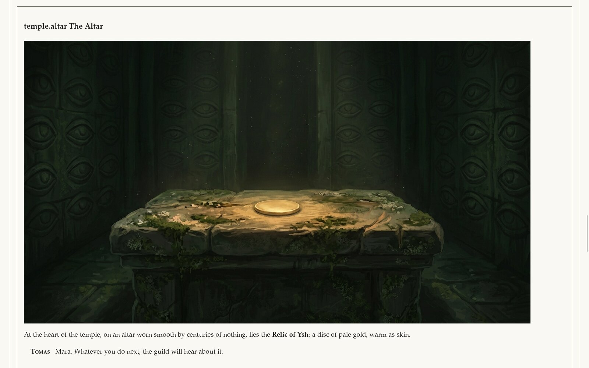
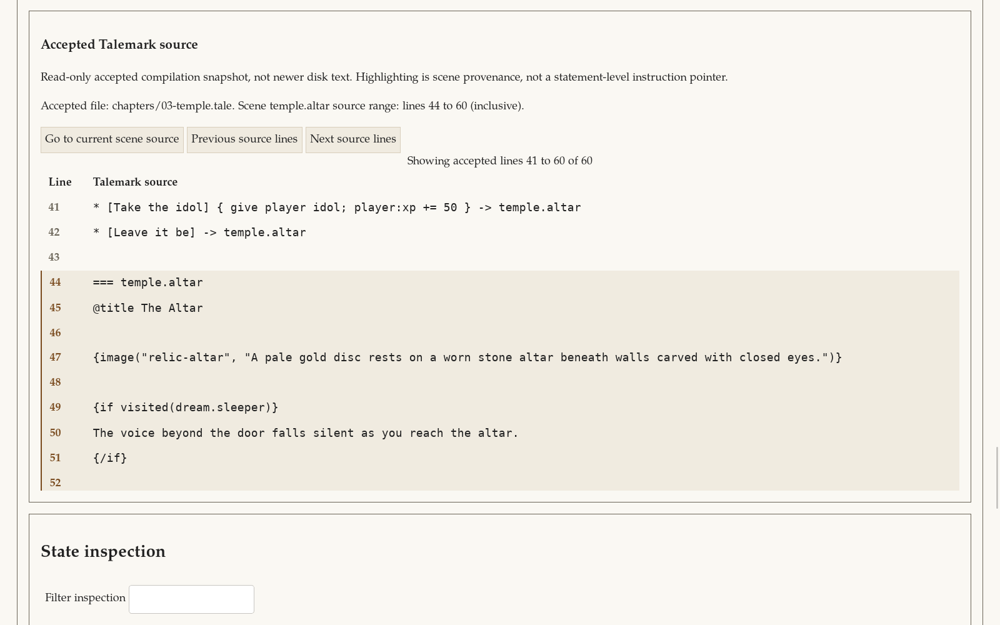
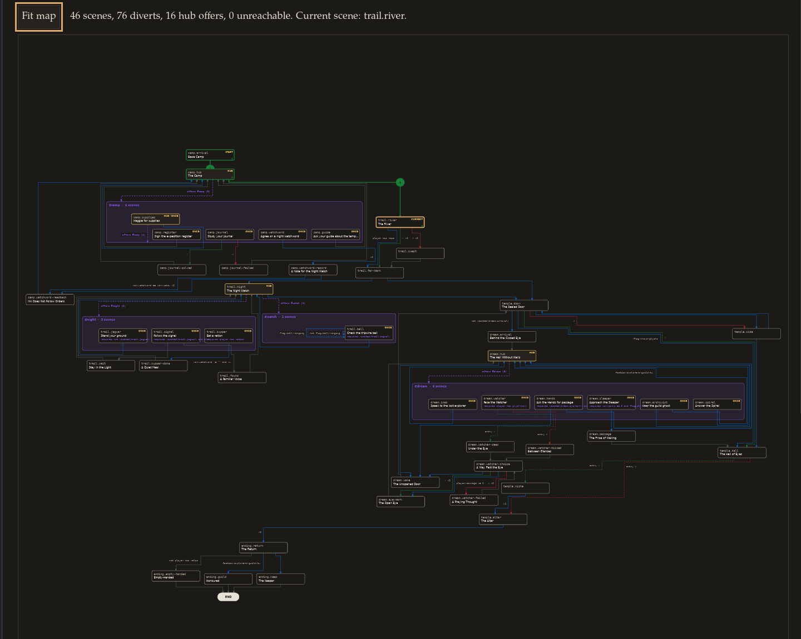

# Testing your story

Talewright checks your whole story every time it loads, so most mistakes show up before anyone plays.
There are three ways to test, from quickest to most thorough.

In VS Code, use **Talewright: Validate Story** and **Talewright: Open Author Debugger** from the
Command Palette (**View > Command Palette**, or **Ctrl+Shift+P**). If VS Code says the CLI is
missing, run **Talewright: Set Up CLI** or see [Get the story-checking tools](cli-installation.md).
The commands below are written as `talewright`. If you use the downloaded tools instead, type
`.\Talewright.Cli.exe` on Windows or `./Talewright.Cli` on Mac/Linux, and put quotation marks
around story paths that contain spaces.

## 1. Open it in a player

Make a story ZIP with **Talewright: Publish Story ZIP** or your file manager, then open it in the
[web player](https://play.trytalewright.com/). If there are errors, you'll see a list instead of the
story. Each line gives the file, line and column, an error code and a description:

```text
intro.tale:4:41  TW2001  Unknown item 'lantern'.
```

Look up any code in the [error code reference](../reference/diagnostics.md). After a change, save,
make a fresh ZIP and open it again; the web player doesn't notice edits by itself.

In VS Code, **Talewright: Run Story** (or `talewright run my-story`) plays your story folder
directly, with no ZIP needed.

## 2. Check it from the command line

```bash
talewright validate my-story
```

This runs the same checks as the players, without opening a window, and prints
`Validation succeeded.` or the list of problems. It also reports **warnings**: things that aren't
errors but are probably mistakes, like a scene that can never be reached. Warnings don't stop the
story from running. Add `--warnings-as-errors` if you want to be strict about them.

Validation finds broken diverts, unknown names, type mistakes (like comparing a stat to a word) and
scenes with no way out. It can't play every possible path for you, so you still need to playtest.

## 3. Jump to any scene with the Author Debugger

Playing from the start to reach scene forty gets old fast. The Author Debugger opens any scene
directly, with whatever game state you need:

```bash
talewright debug my-story
```

To preselect a scene, add `--scene`. You still set up the scene before starting it:

```bash
talewright debug my-story --scene temple.altar
```

In VS Code, **Talewright: Play From This Scene** (or the **Play from here** link above each scene)
does the same for the scene your cursor is in. The debugger opens in its own window; on Linux it
needs the [desktop setup](getting-started.md#linux-desktop-setup).

1. **Search scenes** by ID or title and pick one.
2. Optionally set a **seed** (for repeatable dice) and create the player character.
3. Under **Prerequisite overrides**, set only what the scene needs: flags, variables, stats, items
   or faction standing.
4. Click **Start selected scene** and play from there.



The **State inspection** panel shows the current stats, inventory, flags and variables, the events
that led there, and **Branch explanations**: why each condition passed or failed.

Starting at a scene skips everything before it, so earlier scenes count as unvisited. If a scene
checks `player visited ...`, start at an earlier scene and play forward, or use
**Jump retaining state** (below) to keep the visits you've built up.

### See the source being tested

**Accepted Talemark source** shows the source file of the scene you're on, with the scene's lines
highlighted. It follows you as you choose, jump or go Back and Forward. Use
**Previous source lines** / **Next source lines** to browse, and **Go to current scene source** to
return to the scene. This view is read-only, and shows the version of your story the debugger is
running, which may be behind unsaved or rejected edits.



### Explore and export the story map

The **Map** tab lays out every scene, divert and hub offer. Select a scene to see where it leads and
a preview of its text and choices. The map also marks scenes that can't be reached from the start.
It follows diverts and hubs, but doesn't check whether their conditions can ever be met.

While you play in the debugger, the scenes you've visited and the choices you've taken are
highlighted in order. Use **Export SVG** or **Export PNG** to save the whole map. SVG stays sharp at
any size; a very large map may be too big for PNG, and the debugger will suggest SVG instead.



### Change state without starting over

Open **Live edit values**, turn on the fields you want to change, and click
**Apply live edit batch**. You can change flags, variables (numbers or text), faction standing, and
every character's stats and inventory. Item quantities are the new totals; zero removes an item.
Normal triggers and leveling run afterwards. **Command history and consequences** shows what changed,
including any triggers that fired.

The edit applies to the passage you're on. Text and effects that already ran stay as they were;
the rest of the passage, including its choices, updates to match. If that isn't possible, the edit
is rejected and nothing changes; use **Start selected scene** with prerequisite overrides instead.

To move elsewhere without losing your progress, set **Target scene ID** and click
**Jump retaining state**. This goes straight to that scene, keeping visits, trigger history and
dice. **Start selected scene**, by contrast, throws progress away and starts fresh.

**Back command** and **Forward command** step through choices, edits and jumps, even if your story
turns off Back and Forward for players. Doing something new after going back discards the steps
you went back over. Remember that edited states may not be reachable in real play.

Text variables appear as text, in quotes, so you can tell an empty value from a missing one.
Type text without quotes. To set empty text, turn the override on and leave the field empty.

### Editing while you test

Leave the debugger open while you write. When you save a `.tale` file, it reloads the scene you're
on and keeps the state you built up to reach it.

Some changes can't be applied in place: editing a scene you've already passed through, removing a
scene you're heading to, or any change to `story.talewright.yaml`, even a comment. Then the debugger
asks you to click **Restart from source**. You don't have to set everything up again: it keeps your
selected scene, seed, overrides and character, and tells you about any that no longer exist so you
can fix them.

If a change has errors, the debugger keeps running your last good version and marks it out of date.
Fix the error and save again, or click **Rescan / retry watcher**. If you went Back and have steps
to go Forward to, automatic reload waits: go Forward to the end and click
**Rescan / retry watcher**, or start the scene again. If the debugger can't watch your story folder
at all, see [Troubleshooting](troubleshooting.md#the-debugger-says-it-cant-watch-your-story-folder).

### Share and restore a debugging scenario

You can save a debugging session as a `.twscenario` file and open it again later, or give it to
someone with the same version of your story. It records your character, seed, starting scene,
overrides, choices, edits and jumps, not your story itself.

1. Set **Scenario file path** to a location outside your story folder.
2. Click **Export synthetic scenario**. To replace an existing file, first turn on
   **Confirm replacement of existing scenario file on next export**.
3. Later, open the same story in the debugger, enter that path and click **Import exact scenario**.

If you've changed the story since, exact import is refused. **Adopt scenario to accepted source**
replays it on your current story instead and lists anything that now turns out differently.
Choices are matched by position, so check the result carefully, and export it under a new name.

To start from a player's save, enter its path in **Player save file path (read only)** and click
**Fork compatible player save**. The save itself is never changed, and the debugger never writes
player saves.

Scenario files are a testing aid. A later version of Talewright may not open older ones.

New to the debugger? The [hands-on debugger test plan](debugger-test-plan.md) walks through every
feature with a small story and the results to expect.

Full details: [CLI reference: debug](../reference/cli.md#debug).
