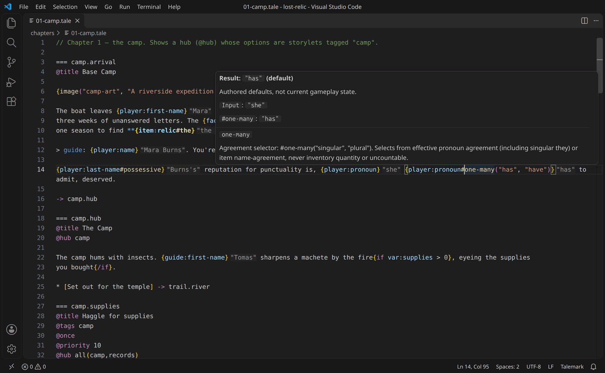

# Talemark syntax reference

A story is a **folder** containing one `story.talewright.yaml`, optional supporting `*.talewright.yaml` files
in subfolders, and any number of `*.tale` files.
**Talemark** is the story-authoring language that powers Talewright stories, written in `.tale` files.
It lets you mix prose with bold and italic formatting, dialogue, choices and story rules. Backticks
are ordinary text.
YAML manifest is a separate settings file for the story's characters and world; it is not Talemark
source. Talemark is not Markdown: it has its own small
[reader-text grammar](talemark-operators.md#reader-text-grammar) for escapes, bold and italic, and a
`.tale` file is not a general Markdown document.

New to Talewright? Start with the [author guide](../guide/README.md). The examples below are a quick
start; the rest of this page is the full reference. You can use the examples as patterns and look up
individual features when you need them.

## Quick start: the shape of a story

A story uses two kinds of files:

- `story.talewright.yaml` is the settings file (also called the **manifest**). It gives your story a
  title, tells Talewright which scene to start with, and names the player character.
- A `.tale` file holds the scenes: the words, dialogue and choices the player sees.

For example, the manifest can start like this:

```yaml
game:
  id: my-story
  title: My Story
  version: 0.1.0
  start: crossroads
characters:
  player:
    first-name: Alex
```

Create a `.tale` file beside the manifest, then write a scene like this:

```tale
=== crossroads
@title The Crossroads

Two paths leave the village.

* [Take the forest path] -> forest
* [Go home] -> END

=== forest
@title The Forest

The trees close behind you.

-> END
```

`=== crossroads` starts a **scene** (one part or place in your story); its name is the scene ID.
`@title` is the heading players see. `@choice-label` sets choice text independently, without adding
a heading; its value is reader text, so it can include substitutions and formatting. Write ordinary
story text on its own lines. A line beginning with `*` makes a **choice**; the words in brackets
are what players click, and `->` says where that choice goes. A bare `* -> scene` uses that scene's
`@choice-label` when present; `* -> END` still shows **Continue**.

To check or play your story without installing the desktop tools, zip its folder and open the zip in
the [web player](https://play.trytalewright.com/). For the full walkthrough, see
[Your first story](../guide/first-story.md).

## How to use this reference

The sections below cover all settings and Talemark features, including optional advanced features.
If you are writing a straightforward story, you can start with the example above and the
[writing guide](../guide/writing-stories.md). You do not need hubs, custom C# rules, or every setting
in this reference to write or share a story.

The whole story is checked when it loads. Mistakes are reported with a file name, line and column,
plus an [error code](diagnostics.md), so you can fix them before playing. C# story projects are an
optional developer feature; see [C# extensions](../developer/csharp-extensions.md).

## Compatibility

Talemark and the engine are versioned together. Talewright is still in early preview, so the
story format can change between releases until 1.0.0-preview.1 ships.

Starting with 1.0.0-preview.1, Talemark syntax, story files and saves will keep working in later 1.x
releases. Syntax will be changed or removed only to fix a severe defect, such as a security or
data-loss bug, with advance notice, an error that shows the replacement, and a migration note. New
syntax may arrive in any release, but only if existing stories compile the same way: syntax that
reserves a character or word existing prose may already use counts as a change, not an addition.

Identifiers are names for scenes, characters, items and other story parts. Use letters, numbers,
underscores, and single dots or hyphens between words; start with a letter or underscore. For example,
`temple.entrance` and `hidden-door` are valid names. A dot groups words in a name; it does not mean
"look inside" another value.
Scene IDs cannot match character IDs, and `scene` is reserved for the current-scene visit-count
reference. `inventory` is reserved as an item ID because it names the inventory in
`player:inventory:rope` and `player:inventory:rope:count`.
Lowercase hyphenated words (kebab-case) are a style recommendation, not a parser restriction.
The naming lint rules TWL001/TWL002 check that style only if you enable them; they do not make an
otherwise valid name illegal.

The [glossary](glossary.md) defines the terms used throughout these docs.
The [Talemark operator registry](talemark-operators.md) is a deeper technical reference for symbols,
calculation order and quoting rules. Most authors will not need it for a first story.

---

## 1. `story.talewright.yaml`

The root manifest owns `game:`. Supporting configuration files may declare `characters`, `items`,
`factions`, `flags`, and numeric or text `vars`, using the same section shapes as the root.
Each declaration kind has one story-wide namespace: paths do not assign scope, ownership, or precedence.
All declarations are collected before references resolve, so a character can use an item declared
in a different file. The required `player` character may also be in a supporting file.

Configuration filenames end in case-sensitive `.talewright.yaml`; unrelated YAML and `.yml` files
are ignored. No additional configuration file is allowed beside the root manifest.
The basename `story.talewright.yaml` is reserved for that single root manifest;
using it in a subfolder is an error, not a nested story.
Reserve the `.talewright.yaml` ending for story configuration rather than unrelated tool files.
For practical layouts, see [Organizing your story](../guide/organizing-your-story.md).
Supporting files cannot contain `game:`. Duplicate identities are errors naming both sources;
there are no includes, overrides, or filename ordering rules. Only one file may declare `triggers:`,
and its list runs in authored order. **Trigger order affects behavior**; keep the list in the root
manifest unless there is a specific reason to move it. Each configuration file contains one YAML mapping document.
Folder, ZIP, embedded, and published stories use the same inputs.

Moving declarations preserves their meaning, but paths and text remain part of the source fingerprint.
Reorganization is a source change, not a guarantee of compatibility with existing saves.
The debugger requires an explicit restart after configuration additions, edits, renames, or deletions.

```yaml
game:
  id: lost-relic # unique; kebab-case is the recommended style
  title: The Lost Relic
  version: 0.1.0
  start: camp.arrival # first scene id
  randomness: checks-only # off | checks-only (default)
  seed: 1234 # optional; omitted = random per playthrough
  undo: true # default; false hides Back/Forward without disabling saves
  autosave: true # default; false stops new automatic recovery writes
  character-sheet: # optional; false hides the sheet, mappings control sections
    stats:
      shown: true # default; false hides the entire stats section
      str: flag:interview.str-known # true, false, or a condition
      wis: false # hidden until its rule becomes true
    inventory: true
    standing: true
  ruleset: # optional; omitted = no stats or levelling (skill checks work on declared stats)
    base: rpg # turns on the built-in RPG stats and levelling
    disable: [cha] # remove stats from the base ruleset
    stats: # add stats
      - id: courage
        name: Courage
        category: attribute # attribute | skill | resource | progression | custom
        min: 0
        max: 10
        default: 0

characters:
  player: # the id "player" is required
    first-name: Mara
    last-name: Burns
    pronouns: she # she | he | they | it, or a custom set (see below)
    stats: { dex: 14, athletics: 2 }
    inventory: [rope, torch] # or { torch: 3 }; quantities are nonnegative (0 means not held)
  guide:
    first-name: Tomas
    pronouns: he

factions:
  explorers-guild: { name: "Explorers' Guild", standing: 0 }

items:
  rope: { name: coil of rope }
  relic: { name: Relic of Ysh, modifiers: { wis: 2 } } # held items modify stats

flags: [door-open, interview.str-known] # optional; flags/vars can also be auto-declared by effects
vars:
  torches-lit: 0
  weather: "sunny"

triggers:
  - id: guild-turns
    when: faction:explorers-guild:tier <= hostile
    do: set flag:guild-hostile
    once: true
```

List-form flags start as false. Use a mapping to set their starting values:
`flags: { door-open: false, guide-trusts-you: true }`. A flag declared by an effect
without a manifest entry also starts as false.

RPG stats are opt-in. Without `game.ruleset`, a story uses the `none` ruleset:
no stats and no levelling, but faction tiers work and `skill-check` works on
any stat the story declares (see [skill checks](#6-skill-checks)).
`ruleset: rpg` is shorthand for `ruleset: { base: rpg }` and turns on the
built-in d20-style stats and levelling. A `ruleset` mapping without `base`
declares only its own `stats` on top of `none`. An unknown ruleset name is an
error (TW4004) that lists the available rulesets.

Manifest booleans use `true` or `false`; quoted `'true'` and `"false"` are also
accepted. Values such as `yes`, `no`, `1`, or `sometimes` produce TW4003.
This applies to `game.undo`, `game.autosave`, `game.character-sheet`,
`game.character-sheet.stats.shown`, `game.character-sheet.inventory`,
`game.character-sheet.standing`, `game.creation.name`, item `uncountable`, and
trigger `once`.

`game.character-sheet` controls what the player's character sheet shows. By
default each section appears when the story declares something for it: stats
when the ruleset has stats, inventory when the story declares items, and
standing when it declares factions. `character-sheet: false` hides the whole
sheet, and the story text takes the full width. A mapping hides only the
sections set to `false`: `character-sheet: { inventory: false, standing: false }`.
`inventory` and `standing` remain booleans. `stats` must be a mapping; the old
scalar `stats: true` and `stats: false` forms are invalid. Unlisted stat IDs are
shown by default. Give a stat `true`, `false`, or a Talemark condition to reveal
it when that condition becomes true:

```yaml
game:
  character-sheet:
    stats:
      shown: true
      str: flag:interview.str-known
      dex: player:dex >= 10
      fear: false
    inventory: true
    standing: true
```

`shown` is a reserved boolean property for the whole stats section and defaults
to `true`; `shown: false` hides every stat regardless of per-stat rules. Stat
conditions use the same boolean expressions as trigger conditions; skill checks
are not allowed. They are re-evaluated against current state whenever visibility
is queried. Unknown or disabled stat IDs and invalid conditions produce compiler
diagnostics. Hiding a stat is presentation only: it still works in conditions,
effects, skill checks and item modifiers. Generated stat notes and inspection
disclosures are suppressed while the stat is hidden; authored prose is unchanged.
Character creation checks visibility against the initial world state and the
playthrough's seed before applying selections or presets. Hidden stats are omitted from direct selection,
but their preset values still apply.

Optional mappings and lists may be omitted. Where empty containers are allowed,
write `{}` or `[]` explicitly. YAML null values (`null`, `~`, or a key with no
value or nested content) are not empty containers and produce TW4003.

Faction entries must be objects, unlike the shorthand allowed for items:
`guild: {}` is valid and defaults the name to `guild` and standing to `0`;
`guild: Explorers Guild` is invalid.

Unknown configuration keys are errors (TW4006) in both the root manifest and
supporting files. The bundled editor schema also rejects unknown keys.

For a complete custom skill declaration, character value and check, see
[Add a skill for your setting](../guide/authoring-recipes.md#add-a-skill-for-your-setting).

Every stat declared with `category: skill`, including a replacement for a built-in
skill, may set optional `governing-attribute: attribute-id`. Its target must resolve to an enabled
`category: attribute` stat after `disable` and all stat declarations/replacements.
Declaration order does not matter. Unknown, disabled or non-attribute targets are
errors, as is using the key on any category other than `skill` (the default
category is `custom`).

For RPG checks, the total is **die roll + skill value +
floor((governing attribute score - 10) / 2)**. Scores and skill values include
effective modifiers such as held items. An unlinked skill uses only its skill
value; omitting the key on a replacement stat leaves that replacement unlinked.
This does not change the RPG formula or allow multiple governing attributes.
With `randomness: off`, the die result is 10.

Custom pronoun set:

```yaml
pronouns:
  {
    subject: xe,
    object: xem,
    possessive-pronoun: { determiner: xyr, independent: xyrs },
    reflexive: xemself,
    agreement: singular,
  }
```

Custom pronoun sets must declare `agreement: singular` or `agreement: plural`.
Built-ins supply this: `she`, `he` and `it` use singular agreement; `they` uses
plural agreement, including when referring to one person ("they are").
Omitted `pronouns` defaults to built-in `they`.

Character `name-agreement: singular|plural` describes the displayed name, independently
of pronoun agreement. It defaults to `singular` and controls name possessives:
`the pack` is singular (`the pack's`), while `the goblins` is plural (`the goblins'`).
For example, `characters: { goblins: { first-name: the goblins, name-agreement: plural, pronouns: they } }`
declares a plural displayed name. A person named Burns using `they` still has a
singular displayed name, rendering `{player:last-name#possessive}` as `Burns's`.
Pronoun possessives use the declared forms (`their` / `theirs`), not name grammar.

Neither field says how many people a character represents. Singular-agreement
pronouns can describe one or more people; plural agreement is not a population
count. Group identity and composition are not modeled by these settings.

There is no `plural` key on pronoun sets or characters; it is reported as an error. Use
`agreement` on the pronoun set and `name-agreement` on the character, choosing each for its
grammar rather than how many people the character represents.

### Optional character creation

Without `creation`, the authored protagonist starts unchanged. With it, the shared
player requires a legal selection before play. The `player` declaration remains
required and provides identity, inventory and other stat defaults.

```yaml
game:
  creation:
    name: true
    pronouns: [they, she, he]
    stats:
      str: [8, 12, 16]
    presets:
      explorer:
        label: Explorer
        stats: {str: 12, hp: 15}
      scholar:
        label: Scholar
        stats: {str: 8, hp: 10}
```

All fields are optional. The first listed pronoun and preset are the defaults.

| Field | Rules |
|---|---|
| `name: true` | Players may edit first and last names (trimmed, at most 80 characters each, first name required, no control characters). Fields start with the authored `player` names; **Use default name** restores them. |
| `pronouns` | Distinct built-in keywords. Omit to keep an authored custom pronoun set. |
| `stats` | Up to 32 stats, each with 1–100 distinct whole-number options within the ruleset's bounds. |
| `presets` | Up to 16. Each sets starting stats within ruleset bounds; values for selectable stats must be listed options. |

**Starting values.** For each selectable stat, the default is the preset's value if the preset sets one,
otherwise the authored `player` value. If that isn't a listed option, or neither exists, the first option
is used. An explicit `0` counts as a value. The player's own picks override the preset.

**During play.** Creation happens before the first scene and is replayed identically by Back, Forward
and loading. Saves keep the created character, and Restart keeps it too. Reopening the story from the
library asks again; loading a save then switches to the saved character.

Not included: point-buy, class designers or race systems.

## 2. Scenes

```tale
=== temple.entrance
@title The Sealed Door
@requires player:dex >= 12 or player has rope
@tags temple
@priority 10
@once

Prose paragraph with **strong**, *emphasis* and literal `backticks`.
{player:first-name#possessive} torch gutters as cold air spills out.

> guide: Careful, {player:first-name}. Nobody has opened this in a thousand years.

~ var:torches-lit += 1

* [Read the glyphs] (requires player:int >= 12) -> temple.glyphs
* [Shove the door] { faction:explorers-guild:standing -= 5 } -> temple.hall
```

For a hub scene that should remain visible while unavailable, add `, shown` to its requirement.
Optional double-quoted reader text replaces the scene title only while that requirement is false:

```tale
@requires player:dex >= 12, shown "You need more strength or a rope."
```

| Element                                            | Meaning                                                                                        |
| -------------------------------------------------- | ---------------------------------------------------------------------------------------------- |
| `=== id`                                           | Starts a scene. IDs use the shared identifier rules; dots may group words, as in `camp.arrival`. |
| `@title text`                                      | Scene heading; fallback text for hub choices without `@choice-label`.                           |
| `@choice-label text`                               | Reader text for hub choices and bare `* -> scene` choices targeting this scene. Does not add a heading; otherwise hub choices fall back to `@title`, then the scene ID, and bare scene diverts show **Continue**. |
| `@continues`                                       | Add this scene's text to the previous passage, without a heading or section break.              |
| `@clear`                                           | Start this scene on a cleared play screen; earlier passages remain in History and saves.        |
| `@requires expr[, shown ["reader text"]]`          | A rule that decides whether a scene is available when using a hub. Without `shown`, a false requirement hides the scene. The optional reader text replaces the normal choice text while unavailable. A skill-check expression may include its own `, hidden` modifier before this optional `shown` suffix. |
| `@tags a, b`                                       | Tags for hubs.                                                                                 |
| `@priority n`                                      | Higher sorts first in hubs (default 0).                                                        |
| `@once`                                            | A scene offered by a hub disappears after the player visits it once.                          |
| `@hub tag`                                         | At this scene, offer each available scene with the tag as a choice.                            |
| `@hub a and b [and c…]`                            | Offer scenes that have every listed tag.                                                      |
| `@hub a or b [or c…]`                              | Offer scenes that have at least one listed tag.                                               |
| `@hub-limit N`                                    | Cap generated hub choices at positive integer N; requires `@hub`.                         |
| blank-line separated text                          | Paragraphs (bold and italic formatting).                                                       |
| `> who: text`                                      | Speaker line; `who` must be a character id.                                                    |
| `{image("path", "alt text")}`                      | Image media in any narrative-template context; alt text is optional. Append `#decorative` only when the image is purely decorative and has no descriptive alt text. |
| `~ effect`                                         | Effect batch applied when this line is reached.                                               |
| `* [label] (requires expr[, shown ["reader text"]]) { effects } -> target` | Choice. `(requires…)` and `{effects}` are optional. Hidden when `requires` is false unless `shown` is present; its optional reader text replaces the label while unavailable. A skill-check expression may include `, hidden` before the optional `shown` suffix. |
| `* -> target`                                      | Textless choice; uses the destination's `@choice-label` when present, otherwise **Continue**. `* -> END` always shows **Continue**. It only supports a divert. |
| `-> target`                                        | Leave now; later lines do not run. Shows **Continue**, or a final frame for `-> END`.          |
| `{if expr}` / `{else}` / `{/if}`                   | Conditionals — on their own lines (block) or inside a paragraph (inline).                      |

Hub selectors use one operator throughout: `and` requires every tag, and `or` requires at least one. Do not mix
them or use either word as a tag name.

Metadata lines are only recognized directly after the `===` header. Lines starting with `//` are comments.

**Branching conversations.** Mark reply scenes with `@continues` to keep a branching exchange together.
The selected choice still appears as the player's line, and every visited scene remains a separate history
step. A continued scene cannot also use `@title` or `@clear`.

**Clearing the play screen.** Mark a scene with `@clear` to hide earlier passages from the play screen.
Those passages remain in History and in saves. Back restores the earlier screen, and Forward or loading a
save rebuilds the screen from the recorded passages.

```tale
=== interview
@title Interview
> guide: What brings you here?
* [I need a job.] -> work
* [I need shelter.] -> shelter

=== work
@continues
> guide: What can you do?
* [I can mend boats.] -> next

=== next
@continues
> guide: We can use that.
* [Thank you.] -> END
```

**Scenes run top to bottom.** Each line sees the state produced by the lines above it, never by
lines below it. Prose and substitutions render when reached. For example:

```tale
=== drawer
{if not flag:searched}
The drawer is still full.
~ set flag:searched
~ give player coin
You take the coin.
{/if}
* [Leave] -> hall
```

The block condition is decided once. Setting `searched` inside the block does not skip its remaining
lines. Change notes such as "Gained:" appear at the effect line, between the surrounding prose.

**Where a scene goes next.** Every choice, including each outcome of a choice skill check, needs
its own `-> target` or `-> END`. Choices are the scene's final block: after the first choice, only
more choices, conditions containing only choices, comments and blank lines are allowed. Choice
requirements and enclosing conditions are evaluated when reached; choice effects run when chosen.

Each choice can have at most one requirement and one effect block, in either order. Both must
come before its divert or `skill-check`. Write a choice requirement as `(requires expression)`,
with whitespace between `requires` and the expression. Writing `(requires: expression)` with a
colon reports TW1011 with a replacement suggestion. An unclosed label reports TW1011 at its opening
`[`. When there is one clear clause boundary, the diagnostic may suggest where to insert `]`.
Append `, shown` to a requirement to keep the choice visible while unavailable. Optionally add
double-quoted reader text to replace the label only while unavailable; it supports substitutions,
`{if}`, formatting and reader-text escapes. `shown ""` is allowed but warns that the choice will
have no text. Without `shown`, a false requirement continues to hide the choice.

Omit a choice's label to show **Continue**, including alongside other choices. This shorthand only
supports a divert; put a conditional textless choice inside a block `{if}`, or add a label to use
`(requires …)` or `{effects}`:

```tale
* [Open the door] (requires flag:ready) -> hall
{if flag:ready}
* -> garden
{/if}
* [Continue] (requires flag:ready) { set flag:left } -> garden
* -> END
```

An omitted label needs an explicit `->` destination and cannot be used with a choice requirement,
effects or skill check. An explicitly empty `[]` is not the textless shortcut. **Continue** is
currently English for both textless choices and automatic scene continuations.

A scene-level `->` leaves immediately, showing the prose already rendered with a single **Continue**
(or as the final frame for `-> END`). Put conditional early exits **before** the choices:

```tale
{if faction:gang:standing <= -31}
-> the-gang-hates-you
{/if}
* [Ask for work] -> gang.work
* [Leave] -> street
```

There is no implicit fallback or gather. A scene without a possible choice, divert or hub is a dead end.
If play reaches a scene whose choice requirements all fail and whose hub offers nothing, the story shows
"The story cannot continue" and ends. Validation does not predict which requirements will hold.

**Advanced: hub selection.** A scene may have only one `@hub` and one
`@hub-limit`. A hub filters by tags, self-exclusion and `@once`, then visits matching scenes in priority
order. It evaluates requirements only until the limit is filled; lower-priority candidates are not
evaluated. Multiple matching tags never duplicate a choice. Explicit choices are not capped. Generated
choices follow written choices when the scene reaches its end. Give a hub an explicit exit choice; a
scene-level `->` leaves immediately instead of offering the hub. These details matter when building a
story around hubs; you can skip them when using direct choices.

For exact selection behavior: tags must be distinct and nonempty; the hub scene itself is never
offered. Higher `@priority` scenes come first, with ties kept in declaration order. The limit applies
only to generated hub choices, not choices written directly in the scene. Shown-but-unavailable
storylets remain eligible for leftover slots after available choices. Because selection is lazy, a
check-dependent requirement below the cutoff never rolls. When checking whether a scene can ever be
reached, Talewright considers all matching tag scenes, even if the current limit would hide some; their
requirements may change later.

**Conditional structure.** A block `{if}` selects one branch once, when reached. Its nested steps run in
order without retesting that condition. Inline conditions are evaluated when their prose line renders.
Block and inline conditions each allow 64 nested `{if}` levels; expressions allow 256 nested groups
and prefix operators combined. Formatting spans allow 64 nested levels. Exceeding any limit reports
TW1016.
Several conditional diverts may precede the choices; the first reached divert ends execution.

**Literal braces.** Write `\{` and `\}` for literal braces in prose. A line starting with `*` followed
by a space or `[` is a choice; `*emphasis*` at the start of a line is prose.

**Reader-text escapes.** A backslash before an ASCII punctuation or symbol character shows that
character literally. For example, `\* [Go] -> hall` is prose, not a choice. A backslash before a
letter, digit, space or non-ASCII character stays visible, as in `C:\stories` and `\—`.

**Reader text is not Markdown.** Talemark implements its own small
[reader-text grammar](talemark-operators.md#reader-text-grammar): word-boundary bold and italic,
inline constructs and ASCII punctuation escapes. Backticks are ordinary text. Italic may use
`*emphasis*` or `_emphasis_`; bold may use `**strong**` or `__strong__`. Unsupported Markdown-like
syntax, including links, entities, headings and lists, remains literal text.
This keeps Markdown-like punctuation from silently consuming your prose or changing its meaning.
The same rules apply to dialogue, choice labels and image alt text, with or without substitutions.

Each line break inside a paragraph renders as a line break. A line whose content renders empty,
such as an inline conditional whose condition is false, does not leave an empty line. A trailing
unpaired backslash reports TW1017; remove it. Disable hard-wrapping for prose and use your
editor's soft wrapping for display instead.

## 3. Substitutions

`{reference#manipulator#manipulator…}`

| Reference                                                                                   | Value                                     |
| ------------------------------------------------------------------------------------------- | ----------------------------------------- |
| `player:first-name`, `player:last-name`, `player:name`                                      | Names (`name` = first + last)             |
| `player:pronoun`                                                                            | Subject pronoun (`she`, `they`)           |
| `player:<stat>`                                                                             | Effective stat value (base + modifiers)   |
| `faction:<id>`                                                                              | Faction display name                      |
| `faction:<id>:standing`                                                                     | Player standing with the faction (number) |
| `faction:<id>:tier`                                                                         | Standing tier name (`friendly`, …)        |
| `faction:<id>:name`, `item:<id>`, `item:<id>:name`                                         | Display names                             |
| `character:inventory:item`, `character:inventory:item:name`                               | The item's display name, even when not held |
| `var:<id>`, `flag:<id>`                                                                     | Story variables / flags                   |

Every property separator is `:`. For example, use `faction:explorers-guild:standing` and
`faction:explorers-guild:tier`. Dots within an ID remain part of that name. Bare faction
references show the faction name; use `:standing` for a number and `:tier` for a reputation tier.
`faction:<id>:name` and `item:<id>:name` are explicit display-name forms.
`character:inventory:<item>` and `character:inventory:<item>:name` are equivalent item-name
references. They read the shared item definition, whether or not that character holds the item;
after a character ID, `inventory` is reserved for this namespace rather than a character property.
The bare `character:inventory` namespace has no printable value.
For these terms, see the [glossary](glossary.md).

Any character id can replace `player`.

| Manipulator         | Effect                                                                                       |
| ------------------- | -------------------------------------------------------------------------------------------- |
| `#possessive`       | Grammatically correct English possessive (Chicago style): `Mara's`, `Burns's`, `the guards'` |
| `#capitalize`       | First letter upper case                                                                      |
| `#upper` / `#lower` | Case                                                                                         |
| `#a`                | Prefix with `a`/`an`; use `some` for plural or uncountable names                               |
| `#the`              | Prefix with `the`                                                                            |
| `#this` / `#that`   | Prefix with `this`/`that`, or `these`/`those` for plural agreement                               |
| `#bold` / `#italic` | Apply bold or italic formatting to the value                                                  |

`#bold` and `#italic` produce formatted text without changing its characters. They may follow
text manipulators, and may be chained with each other; text manipulators cannot follow them. Use
`#upper#bold`, not `#bold#upper`.

Prose formatting is syntax sugar for the same style model: `**{player:first-name}**` and
`{player:first-name#bold}` compile to the same styled substitution. Italic delimiters similarly
correspond to `#italic`. This does not turn a default into an alias: a textless choice still has no
authored label, and its **Continue** label is chosen by the player.

**Pronoun properties.** `{player:pronoun}` is shorthand for `{player:pronoun:subject}`.
Choose a stored form with property access, then chain text manipulators after the value:

| Write                                         | `she`     | `they`       |
| --------------------------------------------- | --------- | ------------ |
| `{player:pronoun}`                            | she       | they         |
| `{player:pronoun:subject}`                    | she       | they         |
| `{player:pronoun:object}`                     | her       | them         |
| `{player:pronoun:possessive-pronoun:determiner}`                 | her       | their        |
| `{player:pronoun:possessive-pronoun:independent}`  | hers      | theirs       |
| `{player:pronoun:reflexive}`                  | herself   | themselves   |
| `{player:pronoun:reflexive#capitalize}`       | Herself   | Themselves   |

The determiner goes before a noun (`her book`); the independent possessive stands
alone (`hers`). Custom sets use their declared `possessive-pronoun` values.
These are ordinary text expressions, usable in comparisons and text assignments:

```tale
{if player:pronoun:object == "her"}She recognizes the voice.{/if}
~ var:remembered-word = (player:pronoun:possessive-pronoun:independent)
```

`#possessive` is a text transformation, not a way to select stored pronoun data.

**Singular and plural wording.** Supply two wordings with
`#one-many("singular", "plural")`:

```tale
{player:pronoun#capitalize} {player:pronoun#one-many("has", "have")} to admit it.
{guide:pronoun#one-many("was", "were")#capitalize} it worth the journey?
```

On a number-valued expression, the first string is selected only when the value
is exactly `1`; every other value selects the second. This works with inventory
counts, stats, number variables and arithmetic:

```tale
{player:inventory:arrow:count} {player:inventory:arrow:count#one-many("arrow remains", "arrows remain")}.
{var:coins - 1#one-many("coin remains", "coins remain")}.
```

Current Talemark numbers are integers. On a pronoun reference, selection reads
the character's effective pronouns at render time, including the player's
character-creation choice. Built-in `she`, `he` and `it` select the first string;
`they` selects the second, including singular they. Custom sets use their required
`agreement` setting. On an item-name reference, selection uses its
`name-agreement`, not inventory quantity.

The selector outputs only the chosen text, not the input value. Both strings are
required (empty strings are allowed); authors control the wording, including
nonstandard grammar. Other text manipulators can follow it, as with `#capitalize`.
Inside these quoted arguments, `\"` means a quote and `\\` means a backslash.
Other backslash escapes are errors. Commas, apostrophes, braces and `#` inside a quoted string are text.

In VS Code, hover a selector to see which wording its default value or agreement chooses:



The selector accepts **number-valued expressions, pronoun references and
item-name references**. Number expressions choose the first string only at
exactly `1`; pronouns use effective agreement and item names use their declared
`name-agreement`. Character names, text variables and other non-number values
are unsupported. Unsupported targets, missing arguments and extra arguments
produce TW2006; an unclosed quote can leave the substitution unclosed (TW1004).
This adds no general multi-argument manipulator support or grammar inference.

### Item-name grammar

Declare the displayed name's grammar, not how many inventory units exist.
Items default to `name-agreement: singular` and `uncountable: false`; shorthand
such as `sword: sword` keeps those defaults.

```yaml
items:
  sword: sword
  amulet: {name: amulet}
  pants: {name: pants, name-agreement: plural}
  handcuffs: {name: handcuffs, name-agreement: plural}
  armor: {name: armor, uncountable: true}
  boots: {name: pair of boots}
```

| Name | `#a` | `#the` | `#this` | `#that` | `#one-many("is", "are")` |
|---|---|---|---|---|---|
| sword | a sword | the sword | this sword | that sword | is |
| amulet | an amulet | the amulet | this amulet | that amulet | is |
| pants | some pants | the pants | these pants | those pants | are |
| handcuffs | some handcuffs | the handcuffs | these handcuffs | those handcuffs | are |
| armor | some armor | the armor | this armor | that armor | is |
| pair of boots | a pair of boots | the pair of boots | this pair of boots | that pair of boots | is |

```tale
{item:pants#that#capitalize} {item:pants#one-many("looks", "look")} expensive.
```

This renders "Those pants look expensive." `#one-many` outputs only the chosen
string, singular first. `uncountable` changes `#a` to `some`, not agreement:
armor still takes "this" and "is". `#possessive` also respects name agreement:
`handcuffs'` and `armor's`.

The original item reference retains its grammar throughout a manipulator chain:
`{item:pants#upper#one-many("is", "are")}` still gives "are". Inventory quantity
does not matter to an item-name reference: one unit of pants remains plural;
five swords do not change the singular displayed name. Use an inventory count
reference when wording should depend on quantity. Assigning
`~ var:word = item:pants` copies only the text "pants", not item identity or
grammar. `{var:word#that}` therefore gives "that pants", and `#one-many` on that
text variable is invalid.

Choose helpers explicitly. They do not infer context, inflect nouns, count items,
or add pair/suit/unit wording. Author exceptional phrasing directly; `#a` retains
the existing a/an rules, not a pronunciation dictionary. These helpers take no
arguments; only `#one-many` accepts its exact two quoted strings.

### Images

```tale
You unfold {image("maps/old_map-v2", "An old map of the northern coast.")}.

> guide: Look at {image("symbols/crown", "The king's crest")}.
* [Take {image("items/coin", "A silver coin")}] -> END
```

Both arguments are double-quoted strings, separated by a comma. The path is required,
relative to the story's `images/` folder, with an optional extension. It is a file path, not a
story identifier, so quote it even when it contains no spaces. The path stays a literal string:
braces in it are filename characters, not substitutions. Alt text is optional:
`{image("maps/old_map-v2")}`. For an image that adds no information, append
`#decorative` to hide it from assistive technology:
`{image("ornament.png")#decorative}`. Do not combine `#decorative` with descriptive
alt text; TW2015 rejects that contradiction. Missing alt on an ordinary image still
warns and uses the filename fallback. TW2016 rejects a choice label that contains only
decorative images, because it has no accessible name. Any label text, substitution or
descriptive image is trusted to name the choice.

Inside either argument, `\"` means a quote and `\\` means a backslash. Any other backslash escape
in the path is an error. Alt text follows the reader-text escape rule: a backslash before any ASCII
punctuation or symbol quotes that character, while a backslash before a letter, digit, whitespace
or non-ASCII character stays visible. Apostrophes, commas, parentheses and brackets are literal
within the quotes. Whitespace is allowed around `image`, parentheses and arguments.

Alt text uses the same template language as prose, rendered with the state where the image appears:

```tale
{image("portrait", "{guide:first-name} at the gate")}
```

That shows the guide's first name. Alt text always uses the reader-text grammar, so `{if}`,
substitutions and formatting work even when no substitution is present. Backticks are ordinary
text. The rendered alt is plain text, since an image description cannot keep bold or italic. For
example, `"**The guide**"` reads `The guide`. Use `\"` for a quote and the reader-text escapes for
literal punctuation. Unknown letter escapes remain literal instead of producing TW1014.
There is no nested `{image(...)}`. Describe the picture in words. A reference the story does not
know, such as an unknown character, is an error at that reference.

The parser preserves a literal alt after escape decoding, including empty or whitespace-only alt text.

Images work wherever narrative templates work: prose, dialogue, choice labels, formatting and
conditions. There is no image-specific surface allowlist or author image-size limit. Plain-string
fields such as scene titles do not gain template support. To show the syntax literally in prose,
escape its outer braces: `\{image("camp")\}`. Backticks do not escape a template.
The character reference `{image:name}` still means the `name` property of the character `image`.

Compilation, `talewright validate` and editor analysis check path safety, supported formats,
file existence, ambiguous extensions and missing alt through the shared resolver's
[TW2010–TW2014 diagnostics](diagnostics.md#tw2xxx-names-and-types). TW2015 rejects
decorative images with descriptive alt text, and TW2016 checks choice labels for an
accessible name.
The editor suggests paths from `images/` in the first quoted argument and refreshes
suggestions and diagnostics when files change. Lookup reads paths, not image bytes.
Omitted, empty or whitespace-only alt warns and uses sentence-case filename fallback.
That fallback is decided from the alt the author wrote, not from text a template later renders
as blank. Explicit literal alt is preserved after escape decoding. Extensionless paths select
`.png`, `.jpg`, `.jpeg`, `.webp` in that order, warning if more than one matches.
Compiled media stores the selected path including `images/`. A literal alt is stored as text.
Alt that contains a substitution or other template is stored as that template and rendered where
the image appears. The filename fallback is stored as text.
The native desktop folder player and native folder Author Debugger display these images,
as do the built-in samples in the desktop and web players. Images load only when their
mounted occurrence approaches the viewport. They fit the available width, retain their
aspect ratio, and use the rendered alt text unless marked decorative. Decorative images
stay visible, including the visible loading-failure message, but are hidden from assistive
technology. Dialogue, choices, chosen-choice history, styles and conditionals use the same renderer.

Folder images are **live files**, not a byte snapshot. Within an accepted story generation,
occurrences of the same resolved filename share a read and Blob URL while any loaded holder
remains. Alt text and style stay independent. After the last holder releases it, a later
occurrence reads again and can see edits or fail after deletion. This avoids duplicate copies,
but does not bound retention of many distinct images; no persistent cache or eviction is added. The
debugger refreshes image occurrences on accepted source/image changes; rejected source
keeps the last accepted story and images. Unavailable or undecodable images show their
effective alt and a visible, accessible failure. There is no remote fallback.

ZIP stories and browser uploads retain their compressed archive for lazy image access through
the same renderer. Untrusted archives enforce defensive expansion accounting, distinct from
folder authoring and the browser upload convenience cap. A later image failure preserves the
story and shows effective alt plus an accessible error.
Published web and desktop hosts also use the shared renderer and include the actual image assets
and catalogue. Web publications keep images as external files under `story/images/`, resolved
relative to the application's base path, including deployment in a subfolder.
Serve a published web game through a web server rather than opening its HTML as a local file.
Desktop publications use the adjacent story folder. Keep the complete published output together.
See [sharing and artwork guidance](../guide/sharing-your-story.md#artwork-and-hosting-size) for
hosting-size warnings and platform verification limits.

The Markdown `` form is not supported and reports TW1015.

## 4. Expressions

```
or / and / not            boolean logic
== != < <= > >=           comparison
+ - * /                   integer arithmetic
player has rope           inventory check (any character id)
player:inventory:rope:count
                          quantity of rope held by a character; 0 if not held
player visited temple.hall
                          whether the player has entered the scene
temple.hall:player:visits  number of times the player has entered the scene
scene:player:visits       number of times the player has entered the current scene
true false 12 "text"      literals
hostile … allied          reputation tier names (compare with faction:<id>:tier)
@CanPickLock              named predicate registered from C# (see C# extensions)
```

Types are checked at compile time (number, bool, text, tier).
Only player visits are tracked. Scene visit counts are numeric, including for hubs; `scene` refers
to the current scene, while `<scene-id>:player:visits` refers to a named scene.
Inventory counts are numeric, read-only references for any declared character and item. An item
not held has a count of `0`; use `give` or `take` effects to change inventory.
Choice history is replay input, not directly queryable in Talemark. There is no general choice or
event-history query syntax; use flags or variables to track other authored history.
Use parentheses to group expressions, for example `(true)`.
Put spaces around subtraction: `player:hp - 3` subtracts three, whereas
`player:hp-3` refers to a stat named `hp-3`. Hyphens and dots are allowed inside identifiers.
See the [operator registry](talemark-operators.md#names-and-values) for exact naming rules.

## 5. Effects

### Text variables

Declare text with a quoted initial value under `vars` in `story.talewright.yaml`:

```yaml
vars:
  weather: "sunny"
  remembered-weather: ""
  numeric-label: "12"
```

Use the same variable references in Talemark:

```text
~ var:remembered-weather = var:weather
~ var:weather = "stormy"
The weather is {var:weather}.
{if var:weather == "stormy"}Find shelter.{/if}
{if var:weather != var:remembered-weather}It has changed.{/if}
```

A variable's initial value fixes its type. Text assignment copies the value at that
moment, not a live link to the source variable. Empty text and non-ASCII text are
preserved. Quoted numbers such as `"12"` are text, not numbers.
Text supports `=` and case-sensitive `==` / `!=`, not arithmetic, `+=`, `-=`,
ordered comparisons, concatenation, or automatic conversion to/from numbers.
### Declaring variables in Talemark

An assignment can introduce a variable without a manifest declaration:

```text
~ var:weather = "stormy"
~ var:remembered-weather = var:weather
```

Declarations are discovered across the whole story before play, so references in
earlier scenes or other files work. Implicit text starts as `""`; implicit numbers
start at zero. Discovery does not execute the assignment: an unvisited scene cannot
change the weather. Assignments only copy values when their effects execute.

Manifest declarations establish types first. Otherwise, the first assignment
establishes the type: `.tale` files are inspected in ordinal path order, effects in
source order (left to right within a list), then trigger effects in manifest order.
That order does not depend on filesystem enumeration or the reader's choices.
Later incompatible assignments are errors, not type changes.

Types can flow through forward references and assignment chains. Arithmetic and
compound assignments require integers. When a chain has no resolvable type (for
example, two variables only assigned from each other), the compiler reports
TW2007: add an explicit manifest initial value to establish the type.

Talemark strings decode `\"` and `\\` exactly once:

```tale
~ var:nickname = "Joel \"big buck\" Bennet"
~ var:path = "C:\\stories"
```

Those values contain ordinary quotes and a single backslash. Spell every literal backslash
as `\\`. Other escapes such as `\n` are errors;
this does not change YAML quoting or ordinary dialogue. Punctuation inside the quotes,
including braces, commas and `#`, remains text. See the
[operator registry](talemark-operators.md#reader-text-quotes-and-escapes) and runnable
[TextVariables example](../../examples/TextVariables).

Separate effects with `;` on a `~` line or inside a choice/outcome's `{ }`.
Triggers and leveling settle after the whole batch, before the next line. For example,
if a character holds 10 credits, `~ take player credits 10; give player credits 7`
never exposes the temporary zero count to triggers.
Writing those effects on two `~` lines creates two batches instead.

```
player:hp -= 3            stat arithmetic (= += -=), clamped to min/max
faction:explorers-guild:standing += 5
var:torches-lit = 2
set flag:door-open        / clear flag:door-open
give player relic         / give player torch 2
take player rope
```

## 6. Skill checks

`skill-check [actor] stat [dc number-expression][, hidden]` is an expression:

- Without `dc`, it returns the ruleset's numeric total (the roll plus modifiers, or the ruleset's
  no-dice result).
- With `dc`, it returns the ruleset's boolean success result; custom rulesets need not use a simple
  `total >= dc` comparison.
- The actor is optional and defaults to `player`. The stat must be declared in the ruleset.
- `, hidden` suppresses the check note, not the check event or its result. Checks are visible by default.

Use the expression in `{if}` conditions, choice `(requires ...)`, scene `@requires`, and numeric
effect assignments. It is also allowed in trigger `do` effects, but not in trigger `when` conditions:

```tale
=== morgue
@requires skill-check perception dc 12, hidden

{if skill-check perception dc 5, hidden}
The wound is clear. {if skill-check perception dc 10}It was made by a serrated blade.{/if}
{/if}

~ var:roll = skill-check perception, hidden
{if var:roll >= 10}You notice something.{/if}
{if var:roll >= 15}You identify it.{/if}

* [Try the shortcut] (requires skill-check guide athletics dc 12, hidden) -> upper-room

::: skill-check perception dc 12
success: -> temple.upper
failure: -> temple.hall
:::
```

The numeric form stores one result for later comparisons; it does not reroll for each threshold.
Separate authored `skill-check` expressions have separate identities, including nested checks of the
same stat. `and`, `or`, and `not` compose normally; boolean operators short-circuit from left to right,
so a check on an unevaluated side does not run. Each expression check resolves at most once per scene
visit, including repeated rendering or evaluation; returning to the scene creates a new visit and a new
result. `::: skill-check ...` blocks and choice checks with `success:` / `failure:` outcomes remain
available for explicit branches. Each outcome's effects run as one batch; a divert leaves immediately.

During play, the check note appears when the result is resolved unless the check is hidden. Scene and
map previews do not execute checks; they mark check-dependent content as depending on the named skill.
Debugger traces and previews do not add events.

Rolls use the keyed deterministic identity from [#268](https://github.com/squid-farm/talewright/issues/268):
scene, actor, stat and source occurrence, plus the scene visit. Prose, source locations, difficulty,
outcomes and checks for other stats do not shift the roll. History, Back/Forward and save/load replay
recompute the same keyed roll and verify the same events. Saved `SkillCheckResolved` events are replay
evidence, not an outcome cache; this feature adds no separately stored result or save-format change.

Both built-in rulesets (`none` and `rpg`) resolve standard checks as `d20 + modifier` against the DC:

- A stat with `category: attribute` adds `floor((score - 10) / 2)`.
- Other stats add their value and, when defined, their governing attribute's modifier.
- With `randomness: off`, the ruleset supplies the deterministic no-dice result.

A C# ruleset can define its own check rule; a ruleset without one rejects `skill-check` (TW3005).

## 7. Diagnostics

Every compiler message has a stable code (`TW1xxx` syntax, `TW2xxx` names and types, `TW3xxx` story
structure, `TW4xxx` story.talewright.yaml) and a `file:line:column` location. See [error codes](diagnostics.md)
for what each one means and how to fix it.
