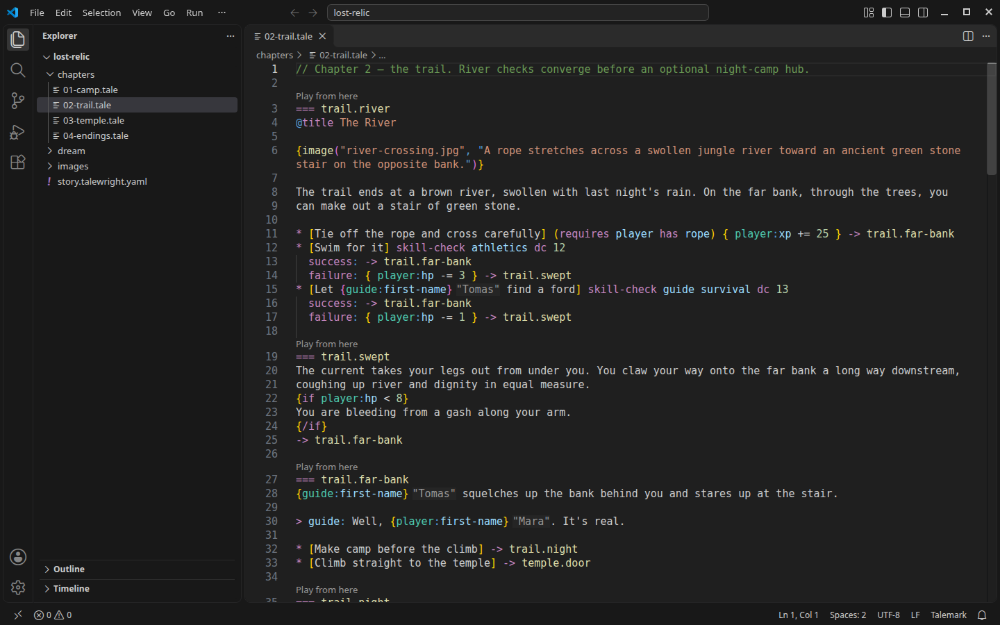
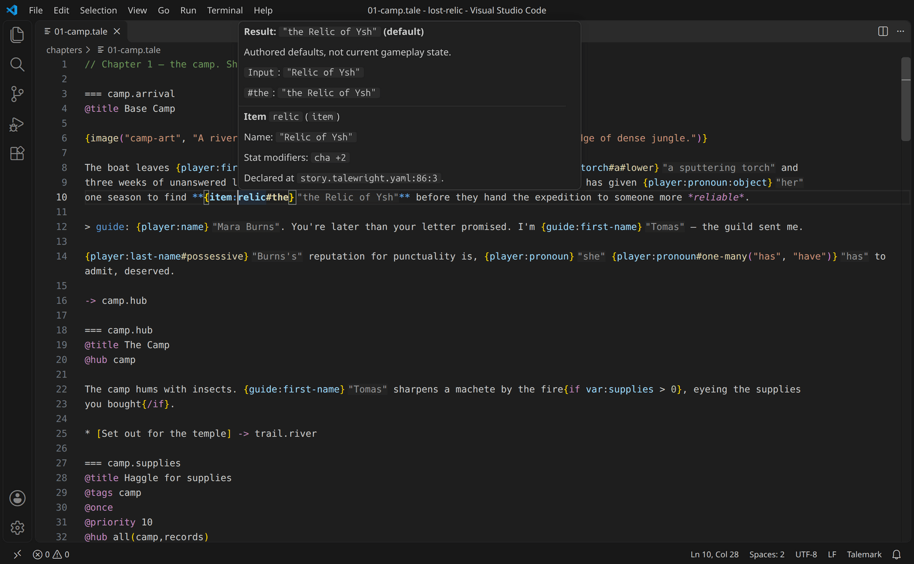

# Talemark for VS Code

Write Talewright stories in **Talemark** (`.tale` files) with syntax highlighting, snippets, story-aware
completion and hover, live compiler diagnostics, rename and quick fixes, without running your story.

[Author cheat sheet: Talemark syntax and VS Code shortcuts](https://github.com/squid-farm/talewright/blob/main/docs/guide/cheat-sheet.md).



## Install

You don't need this extension to write a story: a plain-text editor and the browser player are enough.
The extension makes writing easier. It needs VS Code 1.100 or later.

1. Install the [Red Hat YAML extension](https://marketplace.visualstudio.com/items?itemName=redhat.vscode-yaml).
   It provides the YAML editor features used by the story settings schema.
2. Install **Talewright** by **squid-farm** from
   [the Marketplace](https://marketplace.visualstudio.com/items?itemName=squid-farm.talewright).
   For a preview, choose **Switch to Pre-Release Version**. The Marketplace picks the package for your
   platform automatically. You can also download the matching `.vsix` from
   [GitHub Releases](https://github.com/squid-farm/talewright/releases) and use
   **Extensions > ... > Install from VSIX...**.
3. Open a `.tale` file. The language indicator at the bottom should say **Talemark**.
4. Trust the story folder to turn on live diagnostics and story-aware completion and hover.

Each package includes its own self-contained Talewright language server, so you don't need .NET, the
`talewright` CLI or any build step for editing. The extension starts the bundled server only in trusted
workspaces. It never downloads tools, builds a story project or runs story-project code. Server errors
appear in the **Talewright Language Server** output channel.

**Provisional platform support:** only Linux x64 is tested in an installed editor (on Ubuntu 24.04 and
Linux Mint 22.3). The Windows, macOS and Linux ARM64 packages are built and inspected, but not yet
run in a real editor, so they are offered provisionally. If something fails on your platform, please
[open an issue](https://github.com/squid-farm/talewright/issues) with your OS, architecture and the
**Talewright Language Server** output.

| VSIX target | Extension host | Validation |
|---|---|---|
| `linux-x64` | Linux Intel/AMD 64-bit | Tested in an installed editor |
| `linux-arm64` | Linux ARM64 | Provisional |
| `win32-x64` | Windows Intel/AMD 64-bit | Provisional |
| `win32-arm64` | Windows ARM64 | Provisional |
| `darwin-x64` | macOS Intel | Provisional |
| `darwin-arm64` | macOS Apple Silicon | Provisional |

Alpine/musl, 32-bit, browser-hosted VS Code and universal packages are not supplied. For remote
development, the package must match the remote extension host. The bundled server still needs the
operating system libraries .NET 10 relies on: see
[.NET 10 supported OS versions](https://github.com/dotnet/core/blob/main/release-notes/10.0/supported-os.md)
and [VS Code's requirements](https://code.visualstudio.com/docs/supporting/requirements). On Ubuntu
24.04 these are `libc6`, `libgcc-s1`, `libstdc++6`, `libicu74`, `libssl3t64` and `zlib1g`.

### Language server settings

Leave `talewright.languageServer.command` empty to use the bundled server. Set
`talewright.languageServer.enabled` to `false` for highlighting and schema checks only. To try a
local server build instead:

```json
{
  "talewright.languageServer.command": "dotnet",
  "talewright.languageServer.args": ["/absolute/path/to/Talewright.LanguageServer.dll", "--stdio"]
}
```

Reload the window after changing these settings. To return to the bundled server, clear the command
and set args back to `["--stdio"]`. See
[server setup and other editors](https://github.com/squid-farm/talewright/blob/main/docs/developer/language-server.md).

## Write a scene

Type a prefix, then pick its suggestion (or run **Insert Snippet**). Tab moves between placeholders.

| Prefix | Inserts |
|---|---|
| `tale-scene` | Scene header, prose and a divert |
| `tale-choice` | Choice label and target |
| `tale-if` | Conditional prose, alternate branch and closing marker |
| `tale-choice-check` | Choice skill check with success/failure outcomes |
| `tale-check` | Entry skill check block with both outcomes |
| `tale-image` | An `{image("path", "alt text")}` call |

Replace scene IDs and other placeholders with your story's own names. **Toggle Line Comment** adds and
removes `//` comments. Talemark turns off automatic quote and bracket closing so prose and literal
braces are comfortable to type; you can change that in your settings.

Highlighting distinguishes scene headers, metadata, speech, effects, conditions, choices,
substitutions, checks, bold and italic text, escapes and image calls. Markdown images are marked as
invalid. Colors describe syntax, not whether your story compiles. An unfinished template or emphasis
stops at the end of its line, so it doesn't color the rest of the story.

Inside `image("`, completion suggests supported files from the story's `images/` folder, including
subfolders. Paths are case-sensitive. Adding, renaming or deleting images refreshes suggestions and
diagnostics without reopening the story.

### Find and rename

- **Go to Symbol in Editor** (`Ctrl+Shift+O`, `Cmd+Shift+O` on macOS) lists the scenes in the file;
  **Go to Symbol in Workspace** (`Ctrl+T` / `Cmd+T`) searches scenes by ID or `@title`.
- **Find All References** (`Shift+Alt+F12`, `Shift+Option+F12` on macOS) lists every place the story
  names a scene, character, item, faction, flag, variable, story-declared stat, tag, trigger ID or the
  story ID, in `.tale` and `*.talewright.yaml` files. Each kind of name is matched separately, prose is
  never matched, and unsaved edits are included. Built-in ruleset stats, keywords and names from custom
  C# code aren't listed.
- **Rename Symbol** (`F2`) renames one of those names everywhere in the story, including unsaved files.
  Only the name changes; prose, YAML quoting, comments and filenames are left alone. The rename is
  refused, with a reason, if the new name is invalid, already taken, or would cause a compiler error
  or lint finding. It's also refused for `END`, `player`, built-in ruleset stats, and names near an
  error that could hide a reference. Saved games store these names and aren't migrated, so Talewright
  shows a reminder after a rename. Press Ctrl+Enter (Cmd+Enter) in the rename box to preview changes.

Quick fixes and renames save the files they change (including earlier unsaved edits in those files)
and nothing else. Undo still works. If a save fails, the edits stay in the editor for you to save.

### Quick fixes

- **Missing scene** (`TW2002`): create the scene at the end of this file, or in a new
  `<scene-id>.tale` file next to it.
- **Undeclared flag** (`TW2004`): declare it in the root manifest's `flags`.
- **Unknown character, item or faction** (`TW2001`): declare it in the root manifest.
- **Unknown stat** (`TW2001`): enable the `rpg` ruleset when it provides that stat, or declare a custom
  stat under `game.ruleset.stats` (`category: custom`, `min: 0`, `max: 2147483647`, `default: 0`).
- **Variable read but never set** (`TW2004`): declare it under `vars` as a number (`0`) or text (`""`),
  depending on how it's used. If the use doesn't decide, both are offered.

Manifest edits keep your YAML formatting and comments and use the open manifest, including unsaved
changes. When the manifest can't be edited safely, the fix is shown disabled with a reason.

## Story settings files

The root manifest is `story.talewright.yaml`. Other `*.talewright.yaml` files in subfolders hold more
declarations for the same story; a nested file named `story.talewright.yaml` is an error. With Red Hat
YAML installed, every `*.talewright.yaml` file gets the bundled schema: structure checks, key completion
and field descriptions. The schema doesn't know your story's names; the language server does, and
checks the manifest, supporting files and `.tale` files together. Use
`talewright validate <story-folder>` to check from the command line.

The schema is listed in [SchemaStore](https://www.schemastore.org/), so other editors that use its
catalog pick it up for `*.talewright.yaml` automatically. Otherwise, add this line at the top of
`story.talewright.yaml`:

```yaml
# yaml-language-server: $schema=https://raw.githubusercontent.com/squid-farm/talewright/main/tooling/vscode-talewright/schemas/story.schema.json
```

or point `$schema` at a local copy of [`schemas/story.schema.json`](schemas/story.schema.json). The `main`
URL always describes the current manifest format; to pin it, replace `main` with the release tag for
your Talewright version. The extension always uses its bundled copy.

The schema checks structure and the canonical YAML forms. The compiler is the authority on story
names, custom rulesets, integer bounds and Talemark expressions, and it accepts a few YAML spellings
the schema doesn't; use the forms in the examples for consistent feedback. For example, faction values
must be mappings (`guild: {name: Guild}`). Unknown keys are errors in both (`TW4006`).

Under `vars`, the initial value fixes the type: an integer or quoted text (including `""` and `"12"`).
Talemark assignments such as `~ var:weather = "stormy"` also create variables. Completion and hover
show each variable's type, including unsaved changes.

## Completion, hover and previews

Press **Ctrl+Space** in a divert (`-> dest`), speaker, metadata line, condition or substitution for
story-aware suggestions: scenes, characters, stats, items, factions, flags, variables, predicates and
modifiers. It also completes story values such as `start: "dest"` in the manifest. Plain prose gets no
story suggestions. See [semantic completion](https://github.com/squid-farm/talewright/blob/main/docs/developer/language-server.md#semantic-completion)
for details.

Hover a name for its kind and declaration. Directives and expressions also show syntax help, and
manifest keys show the schema's descriptions. See
[source-aware hover](https://github.com/squid-farm/talewright/blob/main/docs/developer/language-server.md#source-aware-hover).

Substitutions show grey inline previews of their text: `{player:name#upper}` shows `"MARA BURNS"` for
an authored name of Mara Burns. Previews cover character names, pronouns, `#one-many`, item and faction
names, literal values and declared variable defaults, in prose, dialogue and choice labels.



Hover a substitution to see each manipulator step. Previews use the **default** authored values, not
values from a playthrough: effects, triggers, character creation and assignments aren't run. Anything
that depends on gameplay, and custom C# manipulators, show no guessed result. **Talewright: Toggle
Substitution Preview Hints** turns the previews on and off. They never change your files.

Stories with custom C# registrations need exported project metadata for completion and checks; see
[project metadata](https://github.com/squid-farm/talewright/blob/main/docs/developer/language-server.md#client-contract-and-workspace-behavior).
The extension never executes that code.

## CLI actions

These commands use the separately installed `talewright` CLI. The bundled language server is not the
CLI. Find them in the Command Palette (**Ctrl+Shift+P**):

- **Talewright: New Story** creates a starter story in an empty folder (or one you choose) and opens
  `story.tale`. It never overwrites an existing story.
- **Talewright: Validate Story** runs `talewright validate`.
- **Talewright: Publish Story ZIP** asks for a destination and runs `talewright publish`. This makes a
  story ZIP for a Talewright player, not a standalone game. If the file exists, answer the replace
  question in the terminal; the extension never adds `--force`.
- **Talewright: Open Author Debugger** runs `talewright debug` and opens the native Author Debugger
  (not VS Code's debugger).
- **Talewright: Play From This Scene** (also the **Play from here** code lens above each scene, and the
  editor context menu) opens the Author Debugger at that scene. Turn off the code lens with
  `talewright.codeLens.playFromScene`.
- **Talewright: Run Story** runs `talewright run` to play from the start in the native player. It
  needs the [.NET 10 Runtime](https://dotnet.microsoft.com/download/dotnet/10.0); the extension checks
  but never installs it.

Actions use the story containing the active file, the only story in the workspace, or ask you to choose.
They need a trusted workspace and offer to save unsaved story files first. Output and errors stay in
the task terminal; close the debugger or player with **Tasks: Terminate Task**. The debugger and player
need a desktop and the platform webview: WebKitGTK 4.1 on Linux, WebView2 on Windows, WKWebView on macOS.
See the [CLI reference](https://github.com/squid-farm/talewright/blob/main/docs/reference/cli.md).

### Set up the CLI

Run **Talewright: Set Up CLI**, put `talewright` on your PATH, or set `talewright.cli.executablePath`
to the executable. Setup only runs when you ask; opening a story never installs anything.

- An existing configured executable, `talewright` on PATH, or the .NET global tool is used as is.
- With the .NET 10 SDK, setup offers to install the CLI version that matches this extension:
  `dotnet tool install --global Talewright.Cli --version VERSION --source https://api.nuget.org/v3/index.json`,
  in a visible terminal, after you approve it.
- Without the SDK, setup opens the matching [GitHub release](https://github.com/squid-farm/talewright/releases)
  so you can download the standalone CLI. Extract the whole archive, then use **Select Executable**.

The extension never installs the SDK, changes PATH, elevates permissions or updates an existing tool.
See the [author setup guide](https://github.com/squid-farm/talewright/blob/main/docs/guide/cli-installation.md)
and [technical setup notes](https://github.com/squid-farm/talewright/blob/main/docs/developer/cli-setup.md).

### Tasks

To rerun play or debugging quickly, add tasks to `.vscode/tasks.json` yourself (the extension never
edits it) and start them with **Tasks: Run Task**:

```json
{
  "version": "2.0.0",
  "tasks": [{
    "label": "Debug my story",
    "type": "talewright",
    "command": "debug",
    "story": ".",
    "problemMatcher": []
  }, {
    "label": "Play my story",
    "type": "talewright",
    "command": "run",
    "story": ".",
    "problemMatcher": []
  }, {
    "label": "Debug a scene",
    "type": "talewright",
    "command": "debug",
    "story": ".",
    "scene": "scene-id",
    "problemMatcher": []
  }]
}
```

`story` is relative to the workspace folder, or an absolute path inside it. In a multi-root workspace a
relative `story` must match exactly one story. `scene` works only with `debug`. User-level tasks are not
supported.

## Not included

- Signature help, formatting, or VS Code breakpoint debugging (use the Author Debugger).
- Building projects, running story code, network services or telemetry.

The editor helps you write; use `talewright validate <story-folder>` as the final correctness check.
See the [Talemark reference](https://github.com/squid-farm/talewright/blob/main/docs/reference/talemark-syntax.md)
for supported syntax.

## Build and test

These steps are for contributors. For a one-step local install of the CLI, debugger and VSIX on
Linux/macOS, run `python3 tooling/install-dev.py` from the repository root (add `--global-tool` to
replace your global CLI). See
[local development setup](https://github.com/squid-farm/talewright/blob/main/docs/developer/cli-setup.md#install-the-current-checkout-for-local-testing).

Packaging needs Node.js 22+, npm, the .NET 10 SDK, Python 3 and `unzip`. Editor smoke tests need a
display (or `xvfb-run`). From this directory:

```bash
npm ci
npm test
dotnet test ../../engine/tests/Talewright.Talemark.Tests -c Release
npm run package
npm run test:package
npm run test:editor
# On a headless Linux machine, use: xvfb-run -a npm run test:editor
```

- `npm run package` builds `artifacts/talewright.vsix` for Linux x64, with the self-contained server and
  license notices. Set `TALEWRIGHT_VSIX_TARGET` (for example `win32-arm64`) for both `package` and
  `test:package` to build another target as `artifacts/talewright-TARGET.vsix`. Don't package targets
  concurrently in one checkout, and repackage Linux x64 before running the editor smoke.
- `npm run test:package` checks the package contents, native architecture and runtime configuration.
  Cross-target checks are inspections, not native execution tests.
- `npm run test:editor` installs the VSIX into a temporary, isolated VS Code 1.100.3 profile (downloaded
  into `.vscode-test`, or set `VSCODE_EXECUTABLE_PATH`). It checks file association, snippets, typing,
  comments, the YAML schema, and live diagnostics from the bundled server, and that the server doesn't
  start in an untrusted workspace. It never touches your normal profile.
- When you update a shipped server dependency, review its license text in `tests/server-notices.txt`.

Automated tests don't replace a quick manual look: in a fresh profile, open a sample story, check
highlighting against prose in light and dark themes, insert each snippet, type prose with apostrophes
and braces, and check completion and diagnostics in `story.talewright.yaml`.
